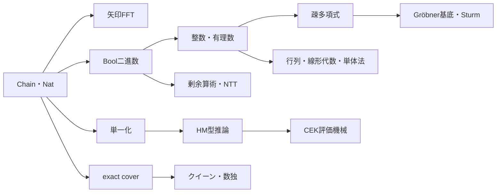

# 純記号アルゴリズム・ハンドブック

## 読み始める順序

まず `tools/moon run src/cmd/main` を実行すると、後述のアルゴリズムの結果をまとめて見られる。
[保存した出力](docs/TOUR.txt)もある。核のソースだけを読む場合は次の経路が分かりやすい。

1. **画像との対応**：coreのChainを読み、fftへ進む。FFTはBinaryもRationalも必要としない。
2. **連結から数へ**：binaryのfull_adderとpair、bitcodecのgamma、modular、NTT、SHA-256へ進む。
3. **木の意味を変える**：unifyの置換とoccurs check、inferのlet多相、cekの評価状態を読む。
4. **厳密計算を積む**：exactからpolynomial、Gröbner/Sturm、またはmatrix/linear/simplexへ進む。

矢印は考え方の依存を示す。正確なimportと公開APIは各moon.pkgとpkg.generated.mbtiが正本。
各話題の検証は同じディレクトリのwbtest.mbtに置く。
性能上の比較は[計測記録](docs/MEASUREMENTS.md)、具体的な検証範囲と限界は以下の各節を参照する。

## 目的と実験の境界

2026-11-15、画像に示された12本の等式による FFT を出発点に、MoonBit の
ADT とパターンマッチだけでどこまで算法を構成できるか試す。
利用者はコードを読んで改造したい人。性能上の実益を後付けせず、表現と計算の関係を調べる。
今回の作業場所は `/home/hosi/morph`、区切りは同日22:00 JST。

「純記号」は**手書きのアルゴリズム本体**に組み込み数値型・数値リテラル・
数値演算・配列・可変状態を使わない、という操作可能な条件とする。
MoonBit のコンパイラ、GC、暗黙の prelude、テストランナーの内部まで排除する主張ではない。
`derive(Eq, Debug)` はテストと観察の補助であり数値計算への抜け道には使わない。
テスト側だけは Int、配列、ループを使い、別表現のオラクルと比較する。

## 開発環境

既存のグローバル環境は MoonBit v0.8.2。変更せず、公式配布を `.tools/moon` に隔離する。
`tools/moon` がこのツールチェーンを優先する。外部 Mooncakes 依存は追加しない。
設定は公式の現行 `moon.mod` / `moon.pkg` 形式を使う。

- [公式インストール](https://www.moonbitlang.com/download/)
- [モジュール設定](https://docs.moonbitlang.com/en/latest/toolchain/moon/module.html)
- [パッケージ設定](https://docs.moonbitlang.com/en/latest/toolchain/moon/package.html)

## 基盤：リストと Peano 自然数

`Chain[A] = Nil | Cons(A, Chain[A])`、`Nat = Zero | Succ(Nat)`。
長さや位置も Nat で表す。加算は Succ の移動、乗算は加算の再帰。
減算はゼロで飽和し、除算のゼロ除数は None で返す。Euclid の GCD も実装。

リストの逆順は蓄積引数を使う。連結の左側だけがコピーされ、右側は共有される。
この性質は、後の二進ワード連結や出力構築のコストを考えるうえで重要。
Peano 数は値に比例する空間を使うため、大きな演算の核には二進 Bool リストを導入する。

複数の幅優先探索で使う二本リストの永続FIFOをcore.queueへまとめた。
後ろ側を反転する償却定数時間の議論は、状態を順番に一度ずつ使う履歴に対するもの。
古い状態から繰り返し分岐すると反転も繰り返す。Eq/Debugは内部表現の観察であり、
異なるfront/backの分け方を持つキュー同士の内容同値判定ではない。

検証：小さい自然数の全組合せをテスト側の Int 演算と照合し、リストの分割・再結合、
逆順の involution、長さ不一致 zip、範囲外アクセスを確認する。

## 二進 Bool リストとペア算術

`Binary` は little endian の `Chain[Bool]` を隠した構造体。
ゼロは Nil、ゼロ以外の末尾ビットは true とする。入口 `from_bits` が正規化し、
それ以降は演算が不変条件を維持する。全加算器は3個の Bool の真理値表。
加算は桁上がり、減算は借り、乗算は shift-and-add、除算は高位桁からの筆算。
負になる減算とゼロ除算は None。累乗は二進指数で平方反復する。
96×96 通りの加減乗除・比較を Int オラクルと比較し、65535→65536 の繰り上がり、
GCD、累乗、単項表現との往復も確認した。

### 連結が算術になる条件

little endian のワード `u` と `v` について、
`value(u ++ v) = value(u) + 2^length(u) * value(v)`。
`[true,false]` と `[true]` は数として同じ1だが、連結に使うと桁幅が違う。
したがって **数の正規化とワードの保存を同じ操作にしてはいけない**。
`concat_words` は生のリストを扱い、`Binary` は数を扱う。

ペアは `pair(a,b) = 2^a(2b+1)` とする。実装は false を a 個並べ、true を区切りにし、
b のビットを連結するだけ。unpair は最初の true までを数える。
これは Nat×Nat と正の Nat の全単射で、ゼロだけはペアを持たない。
a は単項数なので、その値に比例する出力を作る。両座標を常に短く符号化できるという主張ではない。
10×32 通りの往復と数式を照合した。

### 表現コスト

二進 n 桁の加減算・比較は O(n)、学校式乗算・長除算は概ね O(n²) の桁操作。
リスト上の再帰深さと生成ノードは別のコストであり、数値計算ライブラリと同等の実時間とは限らない。
`to_nat` は値そのものの大きさへ展開するので、大きな値の表示・検証には使わない。

## 画像の12等式から FFT

`Arrow = Chain[Unit]`、`Number = Chain[Arrow]`、`Signal = Chain[Number]`。
矢印の長さは常に1で、内側リストの長さが位相を表す。外側の連結が数の加算、
各矢印へのリスト連結が回転になる。`rotate_add` は画像の `mul` に対応する。
画像の `dbl` は数だけでなく、位相ステップと変換結果のリストにも使われる。

特に面白いのは `sub`：半分の FFT の**出力リストを二回並べる**。
後半では回転因子が半周ずれるため、減算という演算を書かなくても radix-two の
`E + w^k O` と `E - w^k O` が表現される。
画像にない前処理として、リストを二個ずつ削る構造的検査で長さが正の2冪か確認する。
不正入力は None。全加算器や整数型は FFT パッケージから参照していない。

### 何をもって同じ複素数とするか

生の矢印リストは正規形ではない。順序が違ったり、一周ぶんの位相が増えたりしても
同じ値を表し得る。入力長 N、ステップ w に対し N*w が一周するという解釈が必要。
テストでは各矢印の位相を一周で割った余りごとに数え、群環 `N[x]/(x^N-1)` の
係数として一致を確認する。これは近似的な複素数比較より強い条件だが、
複素数として同じ全表現を判定する一般の正規化器ではない。

直接 DFT は各出力について入力全部を回り、j*k ステップの回転を構成する別実装。
FFT の分割・mix を再利用せず比較する。長さ1・2・4・8の全278個の Bool 信号、
長さ16の複数矢印・複数ステップの信号で一致した。

### 「Fast」の解釈

butterfly の分割構造は O(N log N)。しかし矢印の明示的な和と単項位相の生成は
単位時間演算ではない。全出力を矢印へ展開すれば出力量そのものが二次的に増え得る。
したがって、この表現の実時間が数値 DFT より速いという結論にはならない。
元投稿の動機と同じく、ここで達成したのは計算をデータ型と等式へ分解すること。

## 符号付き整数と正確な有理数

整数は Bool の符号と Binary の絶対値。負のゼロは作らない。
有理数は符号付き分子と正の二進分母で、GCD によって毎回既約化する。
浮動小数点へ変換せず、加減乗除と比較ができる。
分母ゼロとゼロによる除算は None。負の分母を受け取らない API なので、符号は分子だけにある。

検証は -16..16 の整数全組合せ、約分、正負の分数の演算、ゼロの一意性、
非ゼロ分数を自分自身で割る性質。ここから行列・多項式・厳密な消去法へ進める。
約分に毎回 GCD を使うため、これは高速な有理数演算実装という主張ではない。

## 半環と行列：一つの再帰、三つの意味

`Semiring[A]` は zero、one、plus、times を持つ辞書。
行列積はこの辞書しか知らず、Bool の OR/AND、二進自然数の加算/乗算、
有理数、最小値/加算の熱帯半環を差し替えられる。結合法則・分配法則などは
型だけでは証明できないので、利用側の責任として明記する。

Matrix は横幅 Nat と行リストを隠し、入口で長方形を検査する。
0×N と N×0 も区別するため、空行列から幅を推測する設計にはしなかった。
転置、次元検査付き行列積、単位行列、二進指数の行列累乗を実装した。
Fibonacci Q 行列の10乗から55を得ることを確認。

Warshall は `a_ij <- a_ij plus (a_ik times a_kj)`。
Bool なら到達可能性、非負の min-plus なら全点対最短距離になる。
一般の半環でこの式が無限個の経路の閉包を計算するわけではない。
経路を数える普通の加算・乗算へそのまま適用すると、重複計数するため保証しない。
反射的閉包が必要なら対角へ one を入力する。

検証：3頂点有向グラフ全512通りを、テスト側の配列版 Warshall と比較。
最短距離では重み2+3が直接の重み9を置き換える例、行列の次元不一致、
ragged 入力、ゼロ次元の二回転置を確認した。行列積は O(n³) 個の半環演算。
リスト上の列抽出・単項添字の実コストも含めて性能を評価する必要がある。

## 整理の記録：検証境界をコードで固定

最初の5段階を終えたところで、複数パッケージに重複していた数値変換を
`testsupport` に集約した。各ライブラリはテスト時だけこのパッケージを取り込む。
`tools/audit_purity.py` はコメントと文字列を除き、手書きの核に数値型・数値リテラル・
数値演算・可変状態・配列・FFI がないか検査する。テスト用オラクルの本番 import も拒否する。
これは保守のための保守的なソース検査で、コンパイラが生成するコードや停止性の証明ではない。

`tools/check` で純記号制約、整形、警告なしの型検査、Wasm GC と JS の両テスト、
公開型定義の生成をまとめて実行する。最初の全体検証は両 backend とも13テスト成功。
実行環境は moon 0.1.20261104 / moonc v0.10.20+65efd5b93。

## 安定ソート三種

挿入ソート、マージソート、三分割クイックソートを比較関数つきで実装。
比較結果も Less/Equal/Greater という ADT で扱う。
マージソートの分割は slow/fast の二本のリストで**連続した**半分にする。
交互分割すると、同じキーの要素が左右に分散して元の順序を壊し得るため採用しない。
merge は等しいキーなら左を選ぶ。クイックソートは等値部分列を別に保存する。

0..2 の値からなる長さ0..7の全3280列を配列版 sort と比較し、
元の位置を付けた重複キーで三種とも安定であることを確認した。
マージソートは O(n log n) 比較、挿入ソートと先頭pivotクイックソートは最悪 O(n²)。

## 永続 leftist heap

空または `(右経路のrank, 最小値, 左部分木, 右部分木)` の木。
左右の rank を比較し、右側が短くなるよう node を組み立てる。
二つの heap の merge が基本操作で、挿入と最小値削除はそこから導く。
rank 自体も Nat。比較関数は全操作で同じものを渡す必要がある。
単一要素 heap を二個ずつまとめる bottom-up 構築も用意した。

挿入・削除のたびに heap 順序、rank の一致、leftist 条件を再帰的に検査。
200要素の操作列と、長さ0..59の配列ソートとの一致を確認。
元の空 heap が変更されていないことも確認した。heap sort は安定性を保証しない。
構造上の merge 深さは O(log n) だが、単項 rank の比較コストもかかるため、
機械整数 rank の実装と同じ定数時間モデルにはしていない。

## BFS・Dijkstra・経路復元

有限グラフの頂点は Nat、辺の重みは非負 Binary。入口で頂点重複と未定義端点を拒否する。
BFS は二本リストの queue を使い、発見時点で訪問済みにする。保存した重みは無視して辺数を数える。
Dijkstra は leftist heap に候補を入れ、既に確定した頂点の古い候補を読み飛ばす。
decrease-key を実装せず、永続構造の共有と単純さを優先した。
前駆点から経路を復元し、外部で作られた不正な循環 parent は頂点数ぶんの fuel で停止させる。

3頂点の全512有向単位重みグラフ、全始点で BFS と Dijkstra を整数版 Floyd と比較。
ゼロ重み、多重辺、到達不能、stale 候補、存在しない始点、壊れた parent も検査した。
各辺の探索で辺リストを走査し、確定集合も線形リストで調べるため、
この実装に通常の隣接配列＋hash set の `O((V+E) log V)` をそのまま名乗らせない。
queue の O(1) 償却は線形な操作履歴についての主張であり、過去版から多数に分岐させる永続利用全般ではない。

## トポロジカル順序と強連結成分

Kahn の算法では、残っている頂点から入次数ゼロのものを選び、順に除く。
残りがあるのに選べなければ cycle。自己ループも含めて拒否する。
Kosaraju は最初の DFS の終了順をリストへ積み、転置グラフをその順で再探索する。
色配列や可変 visited 集合は使わず、発見集合と終了順を戻り値で運ぶ。

3頂点の全512有向グラフで、SCC の同値関係を独立な相互到達可能性と比較した。
各頂点が一度だけ出現することも確認。トポロジカル順序の存在は全6順列を列挙して照合し、
返った順序が全頂点を含み全辺を前向きにすることを確認した。空グラフも扱う。
ここでも隣接リストや効率的集合を使っていないため、通常の O(V+E) 実装ではない。

## 配列を使わない動的計画法：編集距離と LCS

格子を行ごとに走査する共通 `grid` を作った。
上・左・左上の値はリストのカーソルと引数で受け渡すため、添字を数える必要がない。
Levenshtein 距離は Nat、LCS は長さと逆順の証拠部分列、編集手順は cost と Edit の列をセルに置く。
Keep/Insert/Delete/Replace の各 Edit も ADT。`apply_script` は元の記号を照合し、壊れた手順を拒否する。

長さ0..5の全63二進語、全3969組について、距離を整数の配列 DP と比較。
編集手順を実行すると目的列になることと費用の最適性を検証した。
LCS は片側の全部分列を列挙する独立オラクルで長さを確かめ、双方の部分列であることも検査。
表のセル更新は O(mn) 回だが、単項 cost の比較や witness の保持のコストは別。
距離だけを求める版は二行ぶんの参照で進められる。証拠を返す版は共有する履歴も保持する。

## 0/1 ナップサックと証拠の共有

重みと容量を Nat、価値を Binary とする。各容量のセルに最適価値と選んだ添字列を保存する。
前の行の `capacity-weight` を毎回 nth で探すと、リスト表現では余分な線形走査になる。
そこで重みの個数だけずらした二本のカーソルを並走させ、一行を線形に構成した。
更新では必ず**前の行**だけを読むので、重みゼロの品物も一回だけ採用する。
同価値なら既存解を維持し、結果の添字は入力順に戻す。

6品物の40系列、容量0..12について全64部分集合を列挙したオラクルと比較。
最適値に加えて、添字の重複がないこと、容量制約、選んだ価値の合計を検証した。
表のセル数は O(品物数×容量) で、二進価値の演算と証拠の保持には別のコストがある。

## 二進剰余算術と拡張 Euclid

Modulus は1より大きい Binary を保持する。合成数も許可し、素数と型名だけで決めつけない。
剰余加減乗算、乗算ごとに還元する平方反復累乗、Bezout 係数を返す拡張 GCD、
互いに素な場合だけ返る逆元、厳密な試し割り素数判定を実装した。
符号付き Bezout 係数には exact.Integer を使う。

法2..31、入力0..39の全組合せを整数演算と比較し、逆元の有無を全候補探索で確認。
小さい指数の剰余累乗、0..39の全組の Bezout 等式、0..255の素数判定を検証した。
試し割りは平方根までの候補を数値ライブラリなしで走査するため、小規模向け。

参考：[Handbook of Applied Cryptography, Chapter 14](https://cacr.uwaterloo.ca/hac/about/chap14.pdf)
は多倍長剰余算術、GCD、累乗の標準的な構成をまとめている。

## 有限体上の NTT・逆変換・線形畳み込み

画像の FFT と同じ偶奇分割を、素数法の二進剰余算術へ移した。
Plan の構築時に長さ N が正の2冪であること、法 p の素数性、
root^N=1、N>1なら root^(N/2)≠1、root と N の逆元を検査して保存する。
2冪についてはこの条件で root の位数が N と分かる。
合成数環では単に位数が合うだけで principal root を保証できないため、入口で除外した。

逆変換は逆根の変換を N の逆元でスケールする。
線形畳み込みは必要長までゼロ埋めし、順変換→点ごとの積→逆変換→切り詰め。
必要な長さは |x|+|y|-1。短すぎる plan は拒否する。
出力は法 p の剰余であり、係数が p を越えた整数多項式積をそのまま復元する API ではない。

法17・長さ8の全256 Bool 信号で、整数版直接 DFT との一致と逆変換の往復を確認。
長さ1..8の各組の畳み込みは独立な学校式積と比較した。法より大きい入力、空積、
長さ1、非原始根、不正長、合成数も検証した。
butterfly は O(N log N) 回の体演算で、矢印を明示展開する版とは表現コストが違う。

分割の原典：[Cooley–Tukey (1965)](https://web.stanford.edu/class/cme324/classics/cooley-tukey.pdf)。
ここでの体への適用と条件検査は、その加算・乗算による分解を有限体で実装し検証したもの。

## 厳密な Gauss–Jordan：解空間まで返す

有理数の非ゼロ判定に成功した証拠を `Nonzero` 型へ包み、ピボットの逆数を全域関数にした。
行交換、ピボット正規化、下方消去、再帰で得た下段ピボットによる上方消去を行う。
RREF とピボット列、および符号付きピボット積を返す。
行交換の符号は最初の非ゼロ行までに飛ばした行数の偶奇を Bool で保持する。

正方行列では full rank ならピボット積が行列式、そうでなければゼロ。
逆行列は (A|I) を一度消去し、左側が全ピボット列である場合に右側を取り出す。
連立方程式は、一意解、特解と零空間基底、矛盾という Solution ADT で分類する。
未知数が自由な場合は自由変数を一つずつ1にして基底を構成する。
空の方程式、未知数ゼロ、非正方行列、右辺の次元不一致も区別する。

検証：全81個の {-1,0,1} 2×2行列の行列式と逆行列を照合。
3×3の30系列は展開公式で比較。矩形系108系列では既知解から右辺を作り、
返る特解が方程式を満たすことと、基底が零空間にあることを確認。
既知の自由変数例で基底そのもの、矛盾系、空の系も検査した。
浮動小数点の誤差はないが、分数の分子・分母の成長と GCD の費用はかかる。

## 整理の記録：実測して中間構造を減らす

Warshall は各pivotで全行列を転置し、その一列だけを使っていた。
必要な列を直接抽出する `column` に置き換え、同じ24頂点の入力・native releaseで
平均665.55µsから361.14µsへ短縮した（各10サンプル）。
全グラフの照合と全体の Wasm GC/JS テストは維持。
詳細条件と生ログは [計測記録](docs/MEASUREMENTS.md) を参照。
有理数除算も、非ゼロの証拠と逆数の共通APIへ寄せ、消去法と重複する符号処理を減らした。
型検査とソース制約の全検証は30テストの時点で再通過。

## DPLL SAT と反証を検査する小さな核

Literal は Nat の変数と Bool の極性、Clause と CNF はリストの入れ子。
DPLL は unit propagation、pure literal elimination、二分岐を使う。
節が空になれば矛盾、CNF が空なら充足。戻り値は部分モデルまたは反証木。
反証木も Conflict / UnitStep / PureStep / Split という ADT で表せる。

`check_refutation` はソルバを呼ばず、各ステップの前提と両分岐を再検査する。
ただし制限操作 restrict は共有しているので、完全に別実装の形式証明ではない。
`check_model` は矛盾する代入を拒否して全節を確認する。外部から来た証拠も検査できる。

3変数について、各変数を不在・正・負とする全27節から作る3節の式全19683通りを、
8代入の真理値表と照合。さらに3リテラル全8極性節の部分集合全256通りを調べた。
分岐が必要な充足不能例、重複リテラル、恒真節、偽造証拠も検証した。
最悪は指数時間であり、watched literals や CDCL 学習は実装していない。

原典：[Davis–Logemann–Loveland, A Machine Program for Theorem-Proving (1962)](https://cs.stanford.edu/content/contacting-donald-knuth/siam-final.pdf)。

## 一階単一化と occurs check

`Term[S] = Variable(Nat) | Node(S, Chain[Term[S]])`。
変数と構成子の記号を別の型で表し、構成子のアルファベット自体もパラメータにした。
単一化では構成子を分解し、変数を束縛し、既存の置換の値域にも新しい束縛を反映する。
置換は外から構築できないので、非循環・冪等という不変条件を守れる。
既存置換に新しい等式を追加する `unify_into` も用意した。

変数が自分を含む項と結ばれると有限項では解を持たないため occurs check で拒否。
構成子名の不一致と引数数の不一致は別のエラーにする。
直接・間接の循環、置換の合成、44項からなる全1936組で、成功した置換が
等式を満たし、二度適用しても変わらないことを確認した。
このテストは最汎性の形式証明ではない。算法は分解・束縛による通常の一階単一化で、
高階単一化や rational tree の循環項は対象にしていない。

## Hindley–Milner 型推論：let 多相まで

一階単一化の構成子を Bool / 関数 / 積へ具体化し、置換と fresh 変数を明示的に渡す
Algorithm W の変形を実装した。入力は Reference/Lambda/Apply/Let/Boolean/Tuple/
First/Second/Conditional という AST。変数名も型変数も Nat なので、文字列や hash table は不要。

let の定義を推論したら、**現在の置換を反映した環境**に自由でない型変数だけを一般化する。
参照時には全称変数へ毎回新しい変数を割り当てる。
lambda の引数には全称変数を持たない scheme を入れ、勝手な多相利用を許さない。
最終結果は量化変数と本体を持つ Scheme。`canonical` が初出順に変数名を整えて比較を助ける。

恒等・定数・合成関数の主型、積と射影、let の異なる型での使用、shadowing を確認した。
一方、lambda 引数の多相使用、外側の変数に依存する let の不正な一般化、自己適用、
未定義名、条件分岐の型不一致は拒否する専用テストを置いた。
パーサ、再帰 let、高階多相、型クラス、効果・可変参照は対象外。
主型算法の実装であり、このコード全体の健全性・完全性を形式証明したという主張ではない。

原典：[Damas–Milner, Principal Type-Schemes for Functional Programs (1982)](https://www.cs.tufts.edu/comp/150FP/archive/robin-milner/damas-milner-original.pdf)。

## 正規表現を二通りの意味で実行する

Regex は空言語・空語・一記号・和・連接・Kleene star の ADT。
Brzozowski 微分は一記号を読んだ後の残りの言語を Regex として作り、
最後に nullable を調べる。空言語・空語の単位則と吸収則を smart constructor で簡約する。
文字列検索ではなく**語全体**とのマッチを実装する。アルファベットも型パラメータ。

別実装として Thompson NFA を構成した。状態番号は Nat、遷移は無音または一記号消費の ADT。
無音閉包は訪問集合で循環を止めるため、nullable な式の star でも停止する。
NFA 実行は微分のコードを使わない。

深さ2以下の構文を構成する全3244式、長さ0..4の全31二進語について両実装を照合。
既知の「末尾が true,false」言語、空言語、空語、nullable loop も確認した。
微分版には ACI 正規化やメモ化を入れていないため、長い入力では式が膨らみ得る。
NFA 版もリスト集合なので、通常のbitset実装と同じ実時間モデルではない。

原典：[Brzozowski (1964)](https://www.oilshell.org/archive/1964_JACM_Brzozowski.pdf)、
[Thompson (1968)](https://www.jmeiners.com/efficient-programming-with-components/papers/regular-expressions.pdf)。

## CEK 機械：評価の途中もデータ型にする

型推論と同じ AST を、call-by-value の CEK 抽象機械で評価する。
Control、字句的 Environment、Continuation の各要素が ADT。
関数は環境を捕捉する Closure、継続は Argument/Function/Binding/Pair/Project/Branch のリストで表す。
ホスト言語の評価の再帰へ丸投げせず、一回の遷移を `step` で取り出した。

`run(machine,fuel)` は全体で fuel 回までの遷移を行う。燃料は Nat。
終了の認識自体も一遷移として数える。ゼロ燃料なら現在状態をそのまま Suspended で返し、
次の run で正確に続けられる。Fault と無限計算の途中の Suspended を混同しない。
これは停止判定器ではなく、利用者が計算予算を渡せる実行器である。

字句スコープと shadowing、積・分岐、一遷移ずつの再開、各型エラーを検査した。
omega の自己適用は1000遷移で Suspended に戻る。
小さい式108個と、それを組み合わせた計972式について、型推論が受理した式は
十分な燃料で Fault なく終わり、結果の外形が推論型と一致することを確認した。
この有限試験を型安全性の一般証明と呼ぶことはしない。

## Huffman 符号：木から Bool リストを生成する

入力の頻度を二進自然数で数え、leftist heap から重みの最小の木を二本ずつ取って結合する。
木の左枝が false、右枝が true。コード表も数値のビット操作を使わずに生成できる。
一記号のアルファベットには空符号でなく [false] を割り当て、反復回数が失われないようにした。
空の入力からはアルファベットを作らず None。既存コードで空メッセージを符号化することはできる。
未知の記号、singleton の不正ビット、途中で切れたコード語は拒否する。

4記号の頻度1..4の全256通りについて、**全結合順序**を列挙した独立オラクルで
重み付き符号長の最適性を比較した。encode/decode の往復、接頭辞自由性、境界例も検査。
等重みでの符号の選択は決定的だが、他の Huffman 実装と同じコード表である必要はない。
tree を送らず bits だけ保存するファイル形式や、canonical Huffman の規格実装は対象外。

## 全体の入口を揃える

45テストが Wasm GC / JS の両方で通った時点で、README に分野別の入口一覧を追加。
`tools/moon run src/cmd/main` で、単なる期待値の表示でなく実際に各 API を呼ぶツアーを用意した。
表示用の数値変換と文字列整形は cmd/main に限定し、核の制約は緩めていない。
`tools/check` はこの境界も検査する。

## 整理の記録：不変条件を使って共有を増やす

単一化の置換は、束縛を追加するたびに既存の全値域へ合成している。
したがって値域には定義域の変数が残らず、変数を引いた後でもう一度置換を走査する必要がない。
この条件をテストで直接調べてから、`apply` が束縛値をそのまま共有するよう変更した。
深さ6の共有項への束縛参照は2.69µsから9.08nsになった。
これは値域参照だけの microbenchmark で、置換構築や型推論全体の速度比ではない。
型推論・CEKとの組合せを含む45テストを両backendで再検証した。
条件と生ログは [計測記録](docs/MEASUREMENTS.md) に残す。

## Bool リストだけで SHA-256

固定長32ビットの Word を不変 Bool リストで表し、回転はリストの分割・連結、
シフトは false の補充、XOR/Ch/Maj は真理値表、加算は全加算器の再帰で行う。
最後の桁上がりを捨てることで法2^32を実現する。64 round の schedule もリストで保持する。
メッセージは big endian のビット列で受け取り、ビット単位の長さを64ビットで符号化して pad する。
2^64ビット以上の入力は仕様の範囲外として None。実用的な最大長まで処理した試験ではない。

定数は [NIST FIPS 180-4](https://nvlpubs.nist.gov/nistpubs/FIPS/NIST.FIPS.180-4.pdf)
§4.2.2 と §5.3.3 の値を Bool のデータとして持つ。
`tools/generate_sha256.py` がそのデータと独立した hashlib fixture を作るが、
アルゴリズム実行時に Python、数値リテラル、平方根・立方根の演算は必要ない。
初期値の第五・第六語の転記順を一度間違え、hashlib が最初の空メッセージで検出した。
仕様の原表で順序を直し、他実装のコメントだけを定数表の正本にしないことを確認した。

検証は標準例3件、hashlib による137系列、
[NIST CAVP のビット単位テスト](https://csrc.nist.gov/Projects/cryptographic-algorithm-validation-program/Secure-Hashing)
の ShortMsg 全513件（長さ0..512ビット）の計653照合。
byte 境界に合わないメッセージ、447/448/449ビット、ブロック末尾、複数ブロックも含む。
fixture の生成器には出典と元データのハッシュを残した。
これは検証用の実装であり、CAVP認証・定時間性・実用品の性能を得たという主張ではない。

## 有理係数の疎多項式

項は有理係数と Nat の指数ベクトル。多項式は変数数を固定し、辞書式順序で降順に並べ、
同じ単項式をまとめ、ゼロ係数を消した正規形にする。入口で指数ベクトルの次元を検査する。
加減乗算、単項式の整除・LCM、項によるスケール、多変数除算、偏微分、厳密評価、
一変数の monic GCD を実装した。

多変数除算は指定された除数の順序で最初に整除できる先頭項を消す。
どれでも消せない項は余りへ移す。各段階で先頭単項式が辞書式順序で下がる。
商も返すため、`f = Σ q_i*g_i + r` を多項式そのもので検査できる。
一般の除数集合では余りが除数順に依存することに注意する。

既知の二変数例、24系列の除算証拠と偏微分の評価、有理点への代入、
共通因子を持つ一変数多項式の GCD、項の打ち消し、ゼロ除数、次元不一致を検証した。
係数や指数が大きくなれば、その表現コストもかかる。

## Buchberger 算法と既約 Gröbner 基底

有理数体上、固定した辞書式単項式順序で実装。
S多項式で二つの先頭項を打ち消し、現在の候補集合で正規化する。
余りが非ゼロなら monic にして追加し、新しい候補との全ペアを待ち行列へ入れる。
全Sペアが処理されたら、冗長な先頭単項式を除き、相互還元し、monic にして整列する。
完成した Basis は入口から勝手に構築できず、未完成の候補集合と区別する。

State は候補とSペア待ち行列を保持し、`run(state,fuel)` が指定回数だけ進む。
fuel はSペア処理回数と最後の相互還元一回を数える。多項式一回の除算自体の費用までは
縛らないため、壁時計時間・メモリ・係数成長の厳密な予算ではない。
一回ずつ再開した結果と、一度に走らせた結果が同じになることを検証した。

独立な [SymPy の groebner](https://docs.sympy.org/latest/modules/polys/reference.html#sympy.polys.polytools.groebner)
を `domain=QQ, order=lex` で実行し、二・三変数の45系について既約基底を完全一致で比較。
有理係数を持つ出力、定数1になる矛盾系、空のイデアル、生成例32系を含む。
全S多項式のゼロへの還元（Buchbergerの判定条件）と元の全生成多項式のゼロへの還元も確認した。
ゼロ・重複生成元、次元不一致、未完成集合を判定器が拒否する例も検査した。
SymPy は fixture を作る開発オラクルに限り、MoonBit の実行時依存にはしない。

原典：[Buchberger の1965年論文の英訳](https://core.ac.uk/download/pdf/82459944.pdf)。
巨大な系を解ける性能や、一般の計算資源上限を達成したという主張ではない。

## 整理の記録：代数の判定条件で計算を省く

Buchberger の積判定を導入した。先頭単項式が互いに素なら、そのS多項式は二つの多項式で
ゼロへ還元できるため、生成と除算を省く。指数リストの同じ位置が両方非ゼロか調べるだけでよい。
燃料は省略したペアも一処理として数え、再開インターフェイスの意味を保つ。
分離二次系では18.51→4.48µs、結合二次系では184.06→111.19µs（native release）。
SymPyの45系と全体97テストを再検証し、条件と生ログを [計測記録](docs/MEASUREMENTS.md) に保存した。

## 一般化された中国剰余定理

既存の拡張 Euclid と符号付き整数を組み合わせ、法が互いに素でない場合も扱う CRT を実装。
差が GCD で割り切れる場合だけ解があり、結果は LCM を法とする一意の合同類になる。
負の差も符号付き係数で処理し、最後に正の剰余へ戻す。
法1を Modulus の型から除いているので、空の制約列は None とする。

法2..12、全剰余の組を、0..m*nの全探索と比較した。
解の有無、最小非負解、結果の法、左右を入れ替えた同値性を確認。
2 mod 3、3 mod 5、2 mod 7 から23を得る多段合成も検証した。

## 小さな RSA を二進演算だけで組み立てる

異なる二素数 p,q を試し割りで確認し、phi=(p−1)(q−1)、e の逆元 d を作る。
平文・暗号文の代表元を法未満に限定し、暗号化と復号は剰余累乗だけで構成する。
p=11,q=13,e=7 では d=103。全143代表元を往復し、pやqと互いに素でないメッセージも含めて検証した。
合成数、同じ素数、逆元がない指数、指数1、範囲外の代表元は拒否する。

これは [RSA 原論文](https://people.csail.mit.edu/rivest/Rsapaper.pdf) の算術部分を試す実装。
padding、乱数による鍵生成、秘密情報の保護、定時間性は備えていない。
通信の安全性を提供する製品実装として扱わない。

## 最大流と最小カットの証拠

Edmonds–Karp を既存 BFS と二進容量で構成した。
各入力辺へ Nat のIDを振り、正方向・逆方向の残余辺を一組ずつ持つ。
平行辺・反平行辺を同じ辺に潰さず、逆辺で以前の流れを取り消す操作も正しく区別する。
BFS の頂点経路を残余辺の経路へ戻し、最小容量を増やして繰り返す。
到達不能になった時点の到達集合が source 側のカットになる。

戻り値には入力辺順の流量とカットを含める。
別の `check` は探索を呼ばず、辺と容量の一致、容量制約、全頂点の流量保存、
source/sink の流量、カットの妥当性、カット容量＝流量を検査する。
実行結果を最適性の証拠として引き継げる。

4頂点・自己ループなしの全4096有向単位容量グラフで、全カット列挙と値を比較。
各結果の証拠も検査した。逆辺での取消が必須の例、平行・反平行辺、自己ループ、
多ビット容量、偽の値やカット、同一source/sinkを別に検証した。
リスト走査、グラフの再構成、二進演算のコストを含むので、通常の配列版と同じ実時間は主張しない。

原典：[Edmonds–Karp (1972)](https://web.eecs.umich.edu/~pettie/matching/Edmonds-Karp-network-flow.pdf)。

## Karatsuba：二進リストの分割統治

a=a_low+2^m*a_high と分ける。low と high の積に加えて、
`(a_low+a_high)(b_low+b_high)−low−high` を計算すれば、四回の半分乗算を三回にできる。
桁シフトは false のリスト連結。負にならない中間減算をチェックし、万一失敗したら
正確な学校式へ戻す。短い・極端に不均衡な入力は学校式へ切り替える。

65..1023桁の複数パターン、全桁trueの繰り上がり、ゼロ、不均衡な入力を学校式と完全一致で比較。
小さい法で還元した積も機械整数の独立オラクルで確認した。
実測では128桁の差は小さく、512桁で約1.78倍、2048桁で約3.09倍だった（native release）。
短い値の既存 multiply を変更せず、karatsuba を別入口にした。
条件と生ログは [計測記録](docs/MEASUREMENTS.md) にある。

## 整理の記録：数値境界の検査自体も確かめる

制約検査に Int32/UInt32 などの別名、文字・文字列リテラル、追加の機械演算トークンを含めた。
コメント内の仕様の数値を誤検出せず、実コードのリテラルを見逃さないことを、検査器自身の
小さなテストで確認する。テスト用 import の例外も basename ではなく実際の cmd/testsupport 配下に限定した。
これは保守的なソース検査であり、MoonBit の型付き AST 全体を解析する完全な証明ではない。
また CRT と逆元で重複した符号付き剰余処理を `signed_reduce` に集約した。

## ビットの構造を使う GCD・平方根・Fibonacci

Stein の GCD は偶数部分をシフトで取り除き、両方奇数なら差の半分へ進む。
整数平方根は n/4 の平方根から候補2個を作り、平方を正確に比較する。
`sqrt_rem` は床の平方根と余りを返すので、近似も丸め誤差もない。
Fibonacci は (F_k,F_(k+1)) から F_(2k) と F_(2k+1) を作る高速二倍法で、
指数の二進リストを一桁ずつ消費する。大きな積には Karatsuba を組み合わせた。

GCD は0..95の全組合せで整数Euclid・長除算版と比較し、大きい2例も Python と照合。
平方根は0..4095を全探索し、127/256/513ビットの非平方数と201ビットの平方付近も確認。
Fibonacci は小さい整数オラクルに加え、F_100/F_200/F_1000 を Python の任意精度整数と完全一致で比較。
大きな値の Cassini 等式も検査した。期待値の生成は `tools/generate_binary_math.py`。
任意精度hex fixture の読み込みと SHA の表示変換は testsupport へまとめた。

## 連結だけでペアを作る、もう一つの方法

二つの canonical 二進数をそのまま連結しても境界は分からない。
例えば true 三個の列は、(1,3) と (3,1) のどちらにも分割できる。
そこで [Elias gamma 符号](https://doi.org/10.1109/TIT.1975.1055349) を使い、
値ではなく**桁数**を単項prefixで示し、big endian の値を続ける。
正の整数の符号は接頭辞自由なので、`gamma(a+1) ++ gamma(b+1)` から両自然数を復元できる。

先の `2^a(2b+1)` は自然数そのものへの全単射だが、aを出力のゼロ列に展開する。
今回の `pair_word` はワードへの自己区切り符号で、両座標のビット長に比例する。
代数的な数への符号化と、通信・保存用のワード符号化の目的を区別した。
数へ正規化してワードの末尾ゼロを落とすと、符号の意味が壊れるので行わない。

0..127の全16384ペア、gammaの正整数1..1024、後続データを残す読み取り、
切れた符号と余計な末尾を検証。601ビットと401ビットの座標を2002ビットに符号化して往復した。
一回でn要素を読む `split_exact` は core に移し、SHA と codec で共有した。

## 永続二分 trie と最長prefix

Bool の一桁ごとに左・右へ進み、各節に Option の値を置く。
空ワードもキーになり、ゼロを含む前後の全ビットを保持する。
lookup、put、remove、prefix以下の部分木、最長一致prefix、整列したentries、union、map を実装。
put/remove はキーの経路だけを作り直し、他の部分木を共有する。
値も子もない節は Empty に戻すので、削除後の空の殻を残さない。

lookup/put/remove はキー長に比例する節操作で済み、連想リスト全体を比較しない。
entries はワードの辞書式順序。可変長little endian数の数値順ではない。
size は左右の Nat を毎回足す代わりに、蓄積値へ一件ずつ Succ を積んで数える。

長さ0..5の全63ワードについて、各挿入後の全lookup、過去版の保持、削除、順序、
完全なpruningを検査した。重なるprefix、空キー、union衝突、mapの合成則も確認した。

## Algorithm X と exact cover

行を「どの列を満たすか」という Nat リストで表し、primary列はちょうど一回、
secondary列は高々一回とする。primaryのうち候補行が最も少ない列を選び、
その列を含む行を順に試す。選んだ行が使う列と、そこへ衝突する全行を不変フィルタで除く。
primary列が空なら成功、一列でも候補ゼロなら失敗する。
解は一つ返し、別の `check` が全列の被覆回数と行ラベルの妥当性を数えて確認する。

4行3列の全4096 incidence行列で、全16行部分集合の列挙と解の存在を照合した。
secondary列の衝突、重複ラベル・列、偽の解も検査した。
最悪は指数探索で、最小列ヒューリスティックは一般の多項式時間保証ではない。
Natの連続添字生成はcoreへまとめ、線形代数の同じ処理も共有した。

## N クイーンを制約の被覆へ翻訳する

各マスへの配置を一つの選択行にし、盤面の行・列をprimary、二種類の斜線をsecondaryにする。
斜線は使われないものもあるので、「高々一回」という制約がちょうど必要になる。
マスのラベルから Nat の divmod で座標を復元し、盤面の行順に整える。
チェック側は斜線一致を `r1+c2 = r2+c1` と変形し、負の整数を導入せずに調べる。

n=0..10で解の存在と、全配置の行・列・斜線制約を独立な整数の検査でも確認した。
返すのは一つの解で、全解数を計算したという意味ではない。
exact cover の説明とsecondary列によるモデル化の参考：
[Knuth, Dancing Links](https://arxiv.org/abs/cs/0011047)。

## 数独も同じ exact cover で解く

一つの候補 `(row,column,value)` が、セル・行と記号・列と記号・箱と記号という
四種類のprimary制約を満たす行になる。箱の一辺 side を Nat で受け取り、
盤面の一辺を side² とするので、同じ関数で1×1、4×4、9×9を扱える。
既知の手掛かりと両立しない候補は、被覆問題を作る前に除外する。

内部の値はゼロ始まり。空欄を値0にせず、手掛かりのリストに存在しないことで表す。
入力アダプターだけが通常の1..9、空欄0という表記を変換する。
全セルを復元し、行・列順に返す。重複セル・範囲外・直接の矛盾を拒否する。

4×4の手掛かりつき・空盤面、9×9の既知問題を解き、後者は既知の完成盤面と完全一致。
別の整数配列の検査で全行・列・箱が1..Nの並べ替えであることと、
ADT側のチェックで全手掛かりが保たれることを確認した。
返すのは一解であり、一般の唯一解判定や大きな盤面の実用性能を主張するものではない。

## 整理の記録：純記号のまま表現コストを下げる

9×9数独の全処理を計測すると、Natの制約IDの比較が繰り返される構造だった。
入口でIDを一度 Binary へ変換してキャッシュし、検索と入力検査で共有するよう変更した。
公開APIと元の問題・解はNatのまま、解の検査も元の制約で行う。
整数・配列・可変状態を導入せず、値に比例するID比較を桁数に比例する比較へ置き換えた。

この数独では平均1.07s→121.81ms（約8.8倍）。入力検査や変換も含む比較である。
全4096被覆問題とNクイーン・数独の検証を維持し、全体117テストも両backendで通過。
キャッシュの追加メモリと、問題ごとの速度差は残る。詳細は [計測記録](docs/MEASUREMENTS.md)。

## 記号微分と、二種類の自動微分

Constant/Variable/Sum/Product/Negative/Power の式ADTを用意した。
係数は有理数、指数は非負Natに限定し、全数値点で定義される多項式の範囲で扱う。
記号微分は和・積・冪の規則で新しい式を作り、smart constructorで定数や単位則を整理する。
これらの恒等則は変数の揃った環境上での多項式の意味についてのもの。

前向きADでは同じ evaluator を Dual（値、方向微分）の半環で解釈する。
逆向きADでは評価値とpullback関数を構成し、最後の一つのseedから全変数への寄与を逆伝播する。
pullbackには末尾リストを渡し、成長した勾配リストを何度も連結する処理を避けた。
最後に同じ変数の寄与を正確に足し、ゼロを消して整列する。

生成した式12種類×有理点8種類、各3変数について、記号微分・前向きAD・逆向きADを
**別表現の疎多項式の偏微分**と比較した。値の一致、ゼロ冪、打ち消し、未定義変数も検査。
浮動小数点の差分近似は使わない。式木を走査する実装で、共有DAGのメモ化や
勾配の連想リスト集約まで含めた線形時間保証を与えるものではない。

関数型pullbackの発展的な参考：
[Pearlmutter–Siskind, Lambda the Ultimate Backpropagator](https://engineering.purdue.edu/~qobi/papers/toplas2008.pdf)。

## 有理数による厳密幾何

Pointの座標を有理数とし、向きは外積の符号を正確に比較する。
Andrewの単調鎖凸包は整列・重複削除・左折を保つstackから構成し、一直線の中間点を除く。
線分交差は、交わらない・一点・重なる線分というADTで返す。
一点へ退化した線分、垂直線、共線の重なり、端点接触を個別に扱う。
単純多角形の面積はshoelace式で計算し、二分の一も有理数のまま返す。
自己交差のある経路では符号付きshoelace和の絶対値であり、領域の和集合面積ではない。

de Casteljauでは隣接制御点の有理補間を繰り返し、Bézier曲線を評価する。
tを単位区間へ丸めず、多項式として外挿もできる。
格子9点の全512部分集合の凸包を、整数のgift wrappingと比較。
全6561線分対の交差有無を整数述語と照合し、有理交点、重なりの両端、
巨大座標に小差を載せた向き判定も確認した。
BézierはBernstein式を展開した独立の整数係数式と、区間外を含む11点で照合した。

## 最小全域森と、最適性を検索せずに調べること

Graphの辺を無向と解釈し、Kruskalは重み順に永続な連結成分を併合する。
Primはleftist heapから境界の最小辺を取り出し、非連結なら未訪問頂点から再開する。
多重辺・逆向きに記録された辺・孤立点・自己ループ・重みゼロを扱う。
結果は入力辺の部分多重集合とBinaryの重み合計。孤立点も全域森の頂点に含める。

検査器は入力辺の使用回数、閉路がないこと、重み合計、元の各辺の両端が森で結ばれることを調べる。
さらに各元辺について、森内の経路の最大重みがその辺の重み以下であることを確認する。
これで、その辺との交換で軽くできないというサイクル最適性条件を確認できる。
これは探索とは別の検査であり、定理証明器による形式証明を生成するものではない。

4頂点の6候補辺に「なし・重み0・1・2」を与える全4096グラフで、
両アルゴリズムの辺数と重みを全64辺部分集合の整数オラクルと比較した。
偽の重み、被覆不足、重すぎる木、自己ループを含む証拠も拒否する。
成分・所属・隣接辺の探索にはリストを使うので、配列union-find版の時間計算量をそのまま主張しない。

参考原論文：[Kruskal 1956](https://doi.org/10.1090/S0002-9939-1956-0078686-7)、
[Prim 1957](https://doi.org/10.1002/j.1538-7305.1957.tb01515.x)。

## 探索を値にして止める：全解列挙

Algorithm Xの未処理フレームを不変リストへ移し、Searchという値にした。
`advance(search,fuel)` は Found(解,続き)、Pending(続き)、Exhaustedを返す。
続きは複製して同じ探索を再生でき、再帰のコールスタックに依存して保持する必要がない。
一解探索と列選択・制約削除・衝突行除去を共有し、二つの実装がずれる余地を減らした。

primaryを満たした後にも、残ったsecondaryだけの行や空行の採用・不採用を列挙する。
これを省くと「一解を返す」用途には十分でも、checkが受け付ける全行部分集合にはならない。
ラベルが一意な有限行集合なので、空行の採用でも必ず候補を一つ除き、有限回で進む。
解の順序は探索順、同じ行集合を異なる選択順で重複して返さない。
燃料は取り出す探索ノード数。候補行の走査や子フレーム生成は一歩の中に含まれるため、
実時間・メモリ上限や一定時間の協調スケジューリングを保証する値ではない。

全4096の4行3列問題で、**全ての有効な16行部分集合との集合一致**を確認した。
空行、primaryが最初から空、secondary衝突、燃料0、一歩ずつの再開、状態の再利用も検査。
Nクイーンの問題エンコードを公開し、n=0..8の全解数を独立な列配置バックトラックと照合した。
結果は `1,1,0,0,2,10,4,40,92`。回転・鏡映でまとめない盤面上の全配置数である。

## CYK：文脈自由文法もADTで扱う

文法規則を Terminal(A,token) と Binary(A,B,C)、構文木を Empty/Leaf/Branch で表す。
入力はChomsky標準形とし、空語を許す場合は開始記号が右辺に現れないことも入口で検査する。
任意文法から標準形への変換器や単位規則・任意位置のepsilon除去は実装していない。
区間長を増やしながら全分割位置を試し、各区間・非終端記号について一つの構文木を保持する。
左再帰や曖昧な文法でも、参照する区間長が真に小さいので再帰的文法の展開で発散しない。

構文木の検査器は使った規則と開始記号とyieldを確認し、chartは作らない。
yieldの再構成は末尾引数で走査し、部分木の文字列を何度も連結しない。
非終端2種類・終端Boolの全4096文法について、長さ0..3の全15語を、
メモ化を使わない別の再帰的導出判定と比較した（61440組）。
括弧列は長さ0..8の全511語でstack深さの整数検査と比較し、
曖昧な左再帰、重複規則、epsilon、偽の構文木、不正文法も確認した。

通常のCYKの区間・分割の数は立方オーダーだが、ここではchartや記号のlookupもリストで行う。
したがって、この実装全体が配列chart版のO(n³)実時間で動くという主張にはしない。
原論文：[Younger, Recognition and parsing of context-free languages in time n³](https://doi.org/10.1016/S0019-9958(67)80007-X)。

## 単体法：近似せず、最適性の根拠も返す

最初の入口は `max c*x; A*x <= b; x >= 0; b >= 0` とした。
原点が必ず実行可能なので、slack変数を基底にしてPhase IIから始められる。
台帳の全係数・比率・目的値は正規化した有理数、添字はNat。
入る変数は負の目的行係数の最小添字、最小比率が同じなら出る基底変数の最小添字を選ぶ。
単なる左端行でのtie breakとは異なるBland規則で、退化した台帳での循環を避ける。
状態を保存し、指定したpivot数でPausedにしてそのまま再開できる。

最適解には primal x、dual y、目的値を添え、検査器が
`x>=0, Ax<=b, y>=0, Aᵀy>=c, c*x=b*y=value` を厳密に確認する。
非有界なら実行可能な点と `d>=0, Ad<=0, c*d>0` という改善方向を返す。
この二つの検査にpivot探索や近似誤差の閾値は不要。

Python標準ライブラリFractionで全境界線対の交点を列挙した独立な2次元オラクルに対し、
符号付き係数、ゼロ境界、冗長制約を含む192問題の最適目的値が一致した。
有理最適値8/3、pivot後の非有界、ゼロ次元、偽の証拠も確認。
古典的な退化循環の4変数台帳も、一歩ずつ再開して有限の最適値1へ到達した。
これは汎用LPソルバーの性能や多項式時間保証を主張する実装ではない。
原論文：[Bland, New Finite Pivoting Rules for the Simplex Method](https://doi.org/10.1287/moor.2.2.103)。

### Phase Iへ拡張：実行不能も証明する

次の段階で b>=0 の制限を外した。負の右辺の行は符号を反転してsurplus・人工変数を入れ、
まず人工変数の和の負を最大化する。Phase Iでも同じBland規則とpivotを使う。
最適値が0なら、値0の人工基底を通常変数へpivotするか冗長行を除き、
人工列を捨てて元の目的行を基底に合わせて再構成し、Phase IIへ進む。
全右辺が非負なら従来通り直接Phase IIから始める。

Phase Iの最適値が負なら、Farkas乗数yを返す。
`y>=0, Aᵀy>=0, b*y<0` を独立に検査でき、
仮にx>=0かつAx<=bなら `0 <= yAx <= yb < 0` となる矛盾が根拠である。
停止値は Optimal/Unbounded/Infeasible/Paused。
外部から作れない台帳の内部不変条件が破れた場合だけInvariantViolationを返す防御分岐を持つ。

独立な2次元頂点列挙を、負の右辺と実行不能を含む**448問題**へ増やし、
実行可能性と最適目的値を照合した。下限制約、重複した等式、冗長制約、
0変数の矛盾、Phase I後の非有界、人工基底のcleanup、一歩ごとの再開も検査。
全ての結果を元の問題に対する証拠検査へ通しており、人工問題だけの成功で済ませない。
変数は非負、制約は<=という標準形。自由変数や等式は利用者側での標準形への変換が必要。

## Sturm列：実数を格納せずに実根を扱う

非零の一変数有理係数多項式を受け取り、まず `f/gcd(f,f')` で重根を一つへまとめる。
これと導関数から「次は除算の余りの負」というSturm列を作る。
各有理点でゼロを飛ばした符号変化数Vを数え、`V(a)-V(b)` が半開区間 **(a,b]** の異なる実根数になる。
±∞での符号は先頭係数と次数の偶奇から決めるので、浮動小数点や巨大な評価点は不要。

端点の扱いは固定要件である。重根を残すと、ある根で列全体が0になってゼロを飛ばす規則が崩れる。
また余りを無条件にmonic化すると、負の係数で割った段で符号変化を壊す。
squarefree化だけをmonicにし、Sturm列の余りは正負を保持する。

monic多項式のCauchy境界 `1+max|非先頭係数|` から全根を含む有理区間を作り、
根数が0なら捨て、1なら採用、2以上なら有理中点で二分する。
隣り合う区間が同じ端点を共有しても (a,b] なので根を二重に含めない。
停止・再開の状態を値で保持し、燃料は処理する区間数。
refineは根数1の区間だけを指定回数二分し、検査器は各区間の根数・順序・全根の被覆を再確認する。
検査器はSturm列を共有しており、独立した定理証明や別方式の根計算ではない。

係数-2..2の三次以下の非零624多項式を、整数の判別式による根数と比較した。
32種類の根集合に重複度1..3を与え、半開区間の端点での根数を既知の有理根と照合。
0と2^-20の近接根、燃料切れ、偽の隔離区間も検査した。
√2の正の根を24回精密化し、両端の平方が2を挟み、区間幅が厳密に3/2^24であることを確認した。
返すのは異なる実根の隔離であり、重複度・複素根・根号式は出力しない。

半開区間の定理の参考：[Isabelle AFP, Sturm Sequences](https://isa-afp.org/entries/Sturm_Sequences.html)。
実装上の符号と係数成長の参考：[FLINTの実根計数・隔離](https://flintlib.org/doc/algorithms/polynomials/real-roots-integers.html)。

## 整理の記録：上位へ進んだら共通算術を測り直す

多項式、最適化、微分、幾何がすべてexact.Rationalを共有する段階で、
分母を掛けてから全体をgcdで約分する方式を見直した。
和は分母のgcdを共有し、積は互いの分子・分母を先に約分する。
既約入力から既約結果が得られるので、最後の巨大な正規化は要らない。
ゼロ、±1、除数1も同じ核で扱い、既存の表現と結果を保った。

交差約分だけでは大きな共通因子の例は改善したが、小さな分数の多い単体法は悪化した。
恒等則を合わせて初めて、今回の単体法は131.72→40.81µs、Sturmは220.82→92.28µsになった。
小分数23409組と既存の上位オラクルを維持した。詳細は[計測記録](docs/MEASUREMENTS.md)。

## Aho–Corasick：Bool列の複数語検索

パターンの全prefixをtrieへ登録し、coreのFIFOで幅優先にfailureリンクと継承出力を作る。
遷移先がなければ、現在のprefixより真に短いfailure先へ進み、同じビットで再試行する。
一致した語の末尾に別の語も一致する場合は、failure先の出力もまとめて報告する。
同じ語に異なるラベルを付けられるが、ラベルの重複は拒否する。

Scannerはオートマトンの状態とNatの入力位置を保持する不変値。
feedしたチャンクの境界をまたぐ一致も保持し、空チャンクを挟んでも結果を重複させない。
空パターンは入力先頭を含む全境界に一致し、最初のfeedだけが先頭の空一致を報告する。
位置は[start,end)。同じendでは長い語から、同語なら入力ラベル順に返す。

長さ0..2の全7語から選ぶ全128辞書と、長さ3までの語を含む256辞書を用意し、
それぞれ長さ0..6の全127入力で全開始位置の素朴な照合と比較した（48768組）。
failureが短いsuffixであること、継承出力、重複語、空辞書、全チャンク分割位置も検査した。

ここでは状態IDをprefix自体で表し、trieのlookupと子prefixの連結も遷移に含まれる。
原論文の定数時間遷移表の線形時間保証を、この表現の実時間へそのまま当てはめない。
原論文：[Aho–Corasick 1975](https://doi.org/10.1145/360825.360855)。

## LZ78：辞書番号と次のビットをペアにする

辞書にある最長prefixを見つけ、その二進番号と次の一ビットをTokenとして出す。
新しい語を辞書へ加え、番号をBinaryのsuccessorで進める。番号0は空語。
入力末尾が既知の語だけで終わった場合は、literal=Noneの最後の参照を使う。
符号化側は語をキーにしたtrie、復号側は二進番号のビットをキーにしたtrieを使う。

実際のビット列は `gamma(prefix+1) ++ [literalがあるか] ++ [あればliteral]` を連結する。
gammaが自己区切りなので、組み込み整数の桁幅や区切り文字を使わずにトークン境界が分かる。
復号は未来・未知番号、途中のNone、空語への終端参照、切れた符号を拒否する。
別の有効なトークン分割を受け付けるため、受理した全符号列の再符号化が同じとは主張しない。
rawなpackはTokenの機械的な直列化であり、任意の不正Tokenの妥当性検査ではない。

長さ0..12の全8191語で、配列辞書を用いた別の逐次的な語分割とトークンまで一致した。
トークン・ビット列の両往復に加え、長さ0..12の全8191ビット列を
整数cursorで読む独立な復号器と比較し、不正入力の判定も確認した。
8192個の同一ビットでは圧縮される一方、一ビットだけの入力は大きくなる。
すべての入力を短くする符号や、既存アーカイブ形式との互換性を主張するものではない。

原論文：[Ziv–Lempel, Compression of Individual Sequences via Variable-Rate Coding](https://doi.org/10.1109/TIT.1978.1055934)。

## 有限体で平方根を求める

Fieldは奇素数pを検査して作り、`p-1=q*2^s` の奇数部分qとNatのs、二次非剰余を保存する。
Euler判定で0・二次剰余・非剰余を区別し、Tonelli–Shanksで平方根を求める。
補正ループは残る2冪位数の指数を真に小さくし、二進の平方反復と剰余積だけで進む。
最後に二乗して入力と一致することを確認し、二つの根のうち小さい方を返す。

128未満の全奇素数について、0..2p-1の全入力を全候補の整数二乗と比較した。
`65537-1=2^16` の体でも、非自明な補正が必要な平方と非剰余を確認した。
標数2と合成数は入口で拒否する。素数検査は試し割り、非剰余探索は決定的な逐次探索であり、
巨大な暗号用素数を入力するための構築コストや定数時間性は備えていない。

アルゴリズムと不変条件の参考：[FLINTのmod p平方根](https://flintlib.org/doc/algorithms/number-theory/sqrt-mod-p.html)。

## 楕円曲線：数の表現から群の演算へ

奇素数体の上で `y²=x³+ax+b` を扱い、標数>3と `4a³+27b² != 0` を入口で確認する。
座標の観察用ADTは Infinity/Affine(x,y)、実際のPointは曲線と検査済み座標を隠して持つ。
異なる曲線の点は加算できない。範囲外の座標は暗黙に丸めず拒否する。
逆元はyの符号反転。加算と倍算は傾きの有理式を体の逆元で計算し、
垂直線とy=0の倍算は無限遠点になる。結果も曲線上にあることを検査する。

スカラーはBinaryの桁を再帰で読み、double-and-addを行う。
圧縮はxとyの偶奇だけを保存し、復元にはTonelli–Shanksを使う。
y=0に奇数側を要求した場合や、xに対応する平方根がない場合も拒否する。
これはADTの符号であり、SEC規格のoctet列の直列化ではない。

p=5,7,11,13の全328非特異曲線について、全点を列挙し、全点対の加算を整数演算と比較した。
全点の圧縮往復、逆元、全xと偶奇の復元判定も確認。
p=17,a=b=2の19点の群では全19³=6859組の結合則、
逐次加算とスカラー倍の一致、2^200+17のスカラーの位数による還元を確認した。
小さな鍵交換の代数例では、5*(7*G)と7*(5*G)が同じ点(10,11)になった。

試し割りによる体の構築、affine逆元、可変な実行経路を持つ教材用の群演算である。
標準暗号曲線のパラメータ・部分群検査・鍵生成・定数時間性を備えた暗号実装ではない。
演算式と圧縮の参考：[SEC 1 v2](https://www.secg.org/sec1-v2.pdf)。

## 永続AVL木：回転もパターンマッチで表す

Emptyと、左右の木・キー・値・高さNat・要素数Binaryを持つBranchで順序付き辞書を作る。
左右の高さの差を検査し、片回転と二重回転の四形をパターンマッチで組み直す。
挿入・上書き・削除は通った経路だけを作り直し、以前の版と他の枝を共有する。
存在しないキーの削除は、変更なしという値を上へ伝え、木をそのまま返す。

部分木サイズを使い、selectは0始まりでk番目、rankは指定キーより小さいキーの数を返す。
どちらの順位もBinary。範囲列挙は[lower,upper)の外の枝を辿らない。
比較関数は全操作で同じ厳密な全順序を使う必要がある。
Eqは木の形の観察であり、別の挿入順で得た辞書の内容同値判定ではない。

7キーの全5040挿入順と逆順削除で、各段階の高さ・サイズ・順序・左右差を
独立な整数再帰で検査した。2048キーの昇順挿入と混合削除、上書き、過去版、
穴のある順位と選択、範囲列挙も確認した。
同じ1024キーで指定した5検索を行うと、連想リスト36.84µs、AVL411nsだった。
構築や更新を含まない特定の検索分布であり、他のアルゴリズム全体の速度比ではない。

高さはO(log n)だが、キー比較や二進サイズの更新自体にも表現上のコストがある。
原論文：[Adelson-Velskii–Landis, An Algorithm for the Organization of Information](https://zhjwpku.com/assets/pdf/AED2-10-avl-paper.pdf)。

## Hopcroft–Karp：最大マッチングと最小頂点被覆

左右の頂点集合を別名前空間のNatで表し、二部グラフの辺を(left,right)の組とする。
幅優先で最短の増加路の層を作り、同じ層に沿うDFSをまとめて試す。
そのphaseで失敗した左頂点を記録し、同じ失敗を繰り返さない。
増加路がなくなると、未対応の左頂点から交互路で到達した集合Zを使い、
`(Left \\ Z_left) ∪ Z_right` という頂点被覆も返す。

検査器は、選んだ辺が元の辺に含まれ、左右の端点が重複しないことと、
返した頂点被覆が全辺を覆い、その頂点数がマッチングの辺数と等しいことを調べる。
任意のマッチングの各辺には異なる被覆頂点が一つ以上必要なので、同数なら両方が最適。
検査には増加路の探索を使わない。

4×4の全65536二部グラフで、全対応の再帰的列挙による最大辺数と一致した。
256例は別のEdmonds–Karpへの単位容量還元とも比較し、辺順を逆転しても同じ大きさだった。
名前空間で同じラベルを使う例、空集合、多重辺、孤立点、不正な対応・被覆も検査した。
層・隣接辺・対応をリストで探索するため、原論文の定数時間アクセスを仮定した計算量を
この実装全体の実時間へそのまま移す主張はしない。

原論文：[Hopcroft–Karp 1973](https://doi.org/10.1137/0202019)。

## 0/1分枝限定法：部品を組み合わせて最適性の木を作る

有理係数の `max c*x; Ax<=b; x_i∈{0,1}` を扱う。
単体法にx<=1を加えた連続緩和を解き、その最適値を上界として使う。
緩和が実行不能なら除外、上界が現在の整数解以下なら枝刈り、
全変数が0/1なら整数解を更新する。それ以外は最初の分数変数を0と1へ分岐する。
非負下限と上限1があるので、緩和が非有界になることはない。

探索状態はタスク・証拠のstackとincumbent。内側の単体法の台帳も保存し、
一歩のLP pivot/cleanupごとに外側の燃料を消費できる。
子問題生成や有理演算もあるので、燃料は一定実時間の単位ではない。
固定した変数は以後の緩和でも0/1のままなので、探索木の深さは変数数以下。
ただし最悪のノード数・保存する証拠の大きさは指数的である。

証拠ADTは Excluded(Farkas乗数)、Bounded(緩和のprimal/dual)、Split(変数,左,右)。
検査器は0/1の候補解が実行可能で目的値が一致することに加え、
各葉が実行不能か、最終目的値以下の上界であることを確認する。
0と1の両枝を検査するため、全二進割当てを覆う。
実行不能の証拠ではBoundedを認めず、全葉にFarkasの矛盾が必要。
検査時に単体法のpivotや整数探索は行わないが、共通の厳密算術とLP証拠検査を信頼する。
形式証明器でこの検査器自体の正しさを証明したものではない。

符号付きの6変数192問題を全64割当てと比較し、最適値と実行可能性が一致した。
別方式のknapsack DPとも、ゼロ重みを含む16入力族×容量0..8の144問題で比較した。
`2x<=1` の緩和上界1/2から整数最適値0への分岐、
`2x=1` の有理解はあるが0/1解はない例、一歩ずつの再開、偽の候補や証拠も確認した。
一般の非負整数・連続変数を混ぜたMILPやcutting planeは対象に含めない。

分枝限定法の原論文：[Land–Doig 1960](https://doi.org/10.2307/1910129)。

## 整理の記録：行基本変形を体の辞書で共有する

Reed–Solomon復号へ進む前に、有理数専用だったGauss–Jordanをrowreduceへ抽出した。
ゼロ・一・和・差・符号反転・積・逆元のField辞書を渡し、
rref、行列式、逆行列、特解と核の基底を同じ実装で計算する。
既存linearの公開型と関数は薄い有理数アダプターとして保ち、従来の独立オラクルを維持する。
有限体はfinitefield.arithmeticから辞書を作る。
Fieldは体の法則を満たす操作の辞書であり、その法則を型で証明したものではない。

F3上の全81個の2×2行列×全9右辺を全9割当てと比較した。
有理4×4逆行列の同じnative releaseベンチは119.50±2.13→118.47±2.27µsで、
誤差範囲が重なるため高速化とは扱わない。ここでの成果は核の重複を避けたこと。
