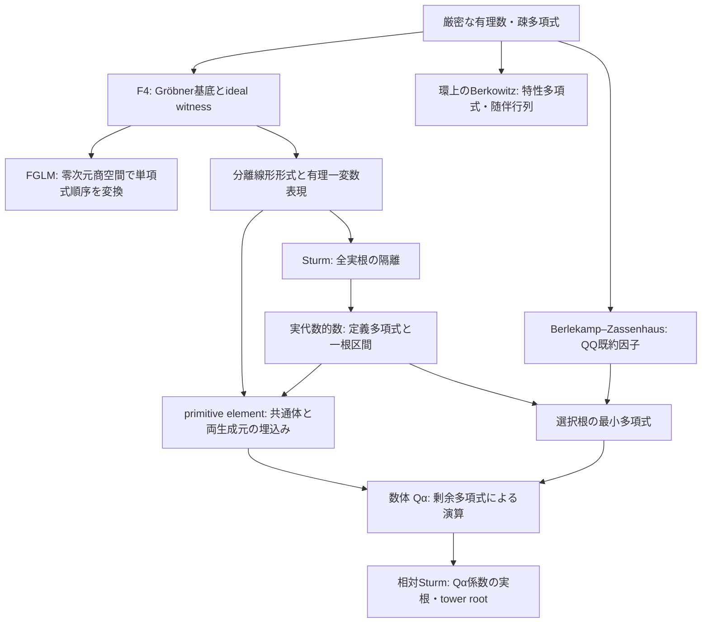

# 厳密代数の計算経路

[ハンドブック](../../HANDBOOK.md) / [ドキュメント](../README.md)

個々の算法をつなぐと、有理数の多項式系から実解を求め、その値をさらに厳密に計算できる。
この章では入口の選び方と、各段階の証拠が何を保証するかを整理する。
基本の表現は[変換と記号計算](symbolic-computation.md)を参照。
`tools/moon run src/cmd/advanced` でこの経路の小例を実行できる（[出力](../ADVANCED_TOUR.txt)・[ソース](../../src/cmd/advanced/main.mbt)）。

## 部品のつながり

矢印は現在の実装上の利用関係を表す。FGLM の出力をそのまま F4 の Basis として扱う型変換はなく、
単項式順序ごとの専用 API と checker を使う。
詳細なパッケージ依存は[生成一覧](../INVENTORY.md)が正本である。

## 多項式系から全実点へ

[F4](../../src/f4)は複数のSペアを行列で同時に簡約し、辞書式の既約 Gröbner 基底を作る。
出力が元の ideal に入る多項式 witness、元入力のゼロ簡約、全Sペアのゼロ簡約を検査する。
単に元の式が出力でゼロになるだけでは、過大な ideal に置き換えた可能性を排除できない。

[FGLM](../../src/fglm)は商空間が有限次元のとき、標準単項式の剰余ベクトルの線形従属を使って
Lex、GradedLex、GrevLex の基底へ変換する。
入力と出力の ideal の両包含、目標順序でのSペアを検査する。
標準単項式の個数上限に届いた場合は未確定であり、正次元と同じ意味にはしない。

[realvariety](../../src/realvariety)は、`g(t), x_i-h_i(t)` の shape が実際に元の ideal と一致することを検査する。
最初の変数選択でこの形にならなければ、補助変数に
`t = x₀+s x₁+s² x₂+...` を加え、有限個の s を順に試せる。
成功した場合は g の全実根を一つずつ隔離し、各根 α に座標 `h_i(α)` を対応させる。
補助変数は元の座標から一意に定まるので、元の次元へ射影できる。

たとえば `x²=2, y²=3` は s=1 のとき、

\[
g(t)=t^4-10t^2+1,\qquad
x=(t^3-9t)/2,\qquad y=(11t-t^3)/2
\]

になる。g の四つの実根が `(±√2,±√3)` の四点に対応する。
根号式を計算核へ持ち込む必要はなく、g と各一根区間と座標多項式が表現になる。
各座標を独立した実代数的数として取り出す入口もある。

非 radical の系や正次元の系では、この探索が成功しない場合がある。
試行回数や F4 の燃料を使い切ったら再開可能な状態を返し、空の実解集合とは区別する。
一般の多変数 CAD や量化消去の完成を意味するものではない。

## 実数の表現と最小多項式

[realalgebraic](../../src/realalgebraic)の Number は、非零の有理多項式と、
その根がちょうど一つ入る半開区間 `(a,b]` から作る。
共役が複数ある場合も区間で値を区別し、比較や四則演算を厳密に行う。
演算で使う resultant は定義多項式を与えるが、最小次数とは限らない。

[realminimal](../../src/realminimal)は定義多項式を QQ 上で完全分解し、
元の区間に選択根を持つ既約因子を取り出す。
Zassenhaus の既約性 checker が Proven の場合だけ、最小多項式への正規化として返す。
余分な因子や重複は除けるが、同じ既約因子の共役を有理係数で除くことはできない。
たとえば √2 の二乗は次数1へ下がり、√2+√3 の最小次数4はそのまま残る。

## 同じ数体の中で計算する

[numberfield](../../src/numberfield)は、検査済みの最小多項式 m と選択した実根から Q(α) を作る。
元は `h(t) mod m(t)` で表し、加減乗算のたびに剰余を取る。
次数は常に `[Q(α):Q]` 未満に収まる。
逆元は多項式の拡張 Euclid 法で作り、`u h+v m=1` の Bézout 恒等式を検査する。
零の逆元は存在しない値として返す。

同じ modulus でも別の共役や区間を持つ context は区別する。
同じ実数を表す別 context の自動同一視や、暗黙の数体合成は行わない。
共通体を作る場合は、[compositum](../../src/compositum)を明示的に使う。
二つの定義多項式のCartesian系を分離線形形式へ落とし、元の選択根と一致する点を選び、
そのパラメータの最小多項式を共通Fieldにする。返す両Elementを元の実数にも照合する。
代数的に従属する入力では、Cartesian系の次数より共通体の次数が下がる場合がある。

一つの数体で反復する計算では、各演算で resultant と共役選択を繰り返さずに済む。
これは表現上の性質であり、全入力に対する性能比較とは別の主張である。

要素自身の最小多項式は、`1,h,h²,...` の最初の有理線形従属から求める。
検査器は消えることに加え、先行する冪の独立性をrankで確認する。
消えるだけの余分な高次数多項式は受理しない。選択した実埋込みの一根区間を使い、
resultantを作り直さずに実代数的Numberへ戻す入口もある。

## 係数体を越える実根

[orderedsturm](../../src/orderedsturm)は、選択した実埋込みの Q(α) を係数とする多項式に
Sturm列を作り、根数・全根隔離・一根区間の精細化を行う。
係数の符号は[Sturm–Tarski](../../src/tarski)で元のαを精細化せずに決定する。
`y²−√2` の根は、この係数体のElementではなく、相対多項式と区間を持つtower rootで表す。
Q(α,β)の一般的な四則演算を提供するものではない。

## 証拠をどの入力へ結び付けるか

| 検査 | 確かめること |
| --- | --- |
| F4 / FGLM | 元入力の ideal と出力基底の関係、単項式順序での基底性 |
| shape / 全根 cover | 一変数表現が元の系と一致し、実根が欠けていないこと |
| 一根区間 | 指定多項式の指定共役を選ぶこと |
| 最小多項式 | 選択根に対する既約な QQ 因子であること |
| 返却値を受け取る checker | 証拠の中身と、実際に返された Number / Point が一致すること |

証拠だけを受け取る API は、その証拠に埋め込まれた問題について検査する。
呼び出し元の問題や返却値との一致が必要なときは、`check_*_result` や入力を受け取る checker を使う。
有限の外部オラクル、問題ごとの証拠、抽象モデルの Lean 証明の範囲は[検証ガイド](../VALIDATION.md)で区別する。

実装ごとの再現条件と未対応例は[研究記録](../research/README.md)に残す。
