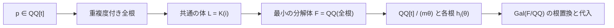

# 多項式の分解体と Galois 群を作る

[ハンドブック](../../HANDBOOK.md) / [複素数体と一生成元](complex-fields.md)

有理係数の一変数多項式 `p` から全複素根を求め、その根が生成する最小の体で計算する。
[complexsplitting](../../src/complexsplitting) は分解体の有理基底、一生成元の最小多項式、
各根の剰余表示を返す。[splittinggalois](../../src/splittinggalois) は、その体の
すべての有理数上の自己同型を、根への具体的な置換と体内の代入として返す。

## 入口と返り値

| 入口 | 用途 |
| --- | --- |
| `complexsplitting.start(p)`、`advance(search,budget)` | 全根の探索から分解体まで進め、未完了の段階から再開する |
| `complexsplitting.solve(p,budget)` | `start` と最初の `advance` をまとめる |
| `start_from_roots(p,L,roots)`、`solve_from_roots` | 一つの `complexfield.Field` に全根と正の重複度を既に持っている場合に使う |
| `start_cartesian(p)` | 因数分解と Cartesian 系を使う一般経路を明示的に選ぶ |
| `splittinggalois.start(splitting)`、`advance(search,trials)` | 検査済みの最小分解体から、自己同型の完全な群を求める |

`Ready(splitting,certificate)` の `roots` は元の CF context にある根と重複度、
`root_images` は同じ順序の一変数多項式と重複度を返す。
`representation` の生成元を `θ` とすると、各根は `hⱼ(θ)` であり、
`hⱼ` の次数は `degree(splitting)` 未満となる。
`modulus` は `θ` の真の最小多項式で、分解体は `QQ[t]/(modulus)` と表示される。

根の重複度 `m` は、元の `p` とその `m−1` 階までの微分が零になり、
`m` 階微分が非零になることから検査する。異なる根の重複度の和が `degree(p)` なので、
根の取りこぼしも検査できる。たとえば `(t²+1)²(t−1)` の重複度は `i:2, −i:2, 1:1`。
重複度を交換して総和だけを保っても受理されない。

## 共通の体から最小の体へ

一般経路は QQ 上の因数分解を先行し、因子ごとに `p(x+iy)` の実部・虚部を零にする実解を求める。
各根の実部・虚部を厳密な実代数的数として取り出し、
[complexcompositum](../../src/complexcompositum) が一つの実数体 `K` にまとめる。
得られる `L=K(i)` は全根を含む共通の計算場所であり、分解体より大きくなることがある。

[complexsubfield](../../src/complexsubfield) は `1` から始め、各根を掛けて有理線形包を閉じる。
独立な積だけを基底へ加え、各基底値が根の単項式であることを証拠に残す。
検査するのは、`1`、単項式の由来、基底の独立性、各根の乗算に対する閉性である。
これにより、根を含む大きな体の基底を混ぜることも、必要な基底を省くことも防ぐ。

| 入力の例 | 共通の体 `L` の次数 | 最小分解体 `F` の次数 | 根への群作用 |
| --- | ---: | ---: | --- |
| 非零定数 | 2 | 1 | 自明群 |
| `t²−2` を `QQ(√2,i)` に置く | 4 | 2 | C2 |
| `(t²+1)²(t−1)` | 2 | 2 | `i` と `−i` の交換 |
| `t³−1` | 4 | 2 | C2 |
| `t³−2` | 12 | 6 | S3 |
| `t⁴−2` の全根を `QQ(⁴√2,i)` に置く | 8 | 8 | 位数8の D4 |

基底 `b₀,…,bᵣ₋₁` が得られると、`c=0,1,…` に対して
`θ(c)=Σ cʲbⱼ` を試す。最小多項式の次数が `r=[F:QQ]` になった候補で一生成元の表示を作る。
座標変換は、ambient 次数を `N` とする `N×r` の冪行列を解くため、`r<N` の場合も扱える。
基底順と最初に成功する候補は返された表示の一部として扱う。

## 二項三次式の直接経路

`p(t)=k(t³−q)`、`k,q∈QQ`、`kq≠0` では、`start` が専用の経路を選ぶ。
実三乗根 `a=∛q` と正の `s=√3` を一回の実数体合成でまとめ、次の順に根を作る。

\[
a,\qquad -\frac a2+\frac{as}{2}i,\qquad -\frac a2-\frac{as}{2}i.
\]

第2根の虚部の符号は `a` と同じで、`q<0` なら負になる。
根番号はこの返却順に従う。置換を解釈するときも、虚部の符号から番号を推測せず `roots` を参照する。
`q=0` の重根は一般経路で扱う。

`q=2` では `L=QQ(∛2,√3,i)` の次数が12であり、根が生成する体は
`F=QQ(∛2,ω)`、`ω=(-1+i√3)/2` の次数6となる。
`i√3=2ω+1` は `F` に入る。`i` と `√3` を個々に渡すと、`F` への所属検査は拒否する。
`q=1` では実三乗根が有理数なので、共通体の次数4から `QQ(ω)` の次数2へ縮む。

## 根の置換を体の自己同型として検査する

`splittinggalois` は異なる根の置換を一つずつ生成し、単項式の証拠に代入して `θ` の像 `θ′` を提案する。
候補は `F` に属し、`mθ(θ′)=0` と、すべての根について
`hⱼ(θ′)=root[π(j)]` を満たす必要がある。重複度も保存する。

`r=[F:QQ]` 個の異なる有効な像がそろうと、すべての自己同型を得たことになる。
`automorphisms`、`permutation`、`generator_image` で作用を読み、`apply` で `F` の元へ適用できる。
`compose(group,left,right)` は right の後に left を適用する。
合成表、単位元、逆元は実際の体内代入と根置換の両方に一致する。

返るのは具体的な置換群である。S3、D4 という名前は小さい例の独立な照合から識別する。
一般の群名を判定する認識器や resolvent による分類、[固定体](galois-fixed-fields.md)への接続は別の機能となる。

## 未完了を引き継ぐ

`Ready`、`Paused`、`Err` は別の結果である。非零定数の分解体は QQ、根の列は空となる。
零多項式は `ZeroPolynomial`、一変数でない入力は `NotUnivariate` を返す。
不足した探索・検証予算を、空の根集合や成功に置き換えない。

`Budget.algebra` は因数分解、根探索、座標、体合成、検証に使う段階ごとの予算、
`primitive` は整数候補を丸ごと試す回数である。Galois 群の `advance` も完成した置換候補を数える。
零予算では自明群でも置換の試行前に停止し、同じ状態から再開できる。
一つの有理演算、最小多項式、線形方程式、最終の証拠検査や合成表作成の実時間は、この回数で制限されない。

一般の QQ 一変数多項式を対象とする有限の構成だが、次数・係数・証拠は大きくなり得る。
Cartesian 系には因子次数 `d` に対して `d²` の組が現れ、根置換の探索は最悪で階乗個の候補を持つ。
高次数での実用時間を保証する API ではない。
証拠の役割と独立参照は[研究記録](../research/complex-splitting-20261117.md)を参照。
