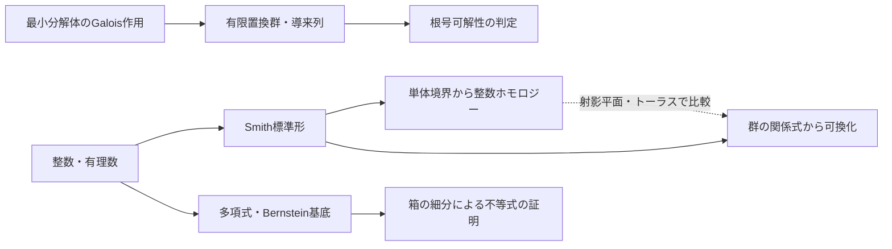

# 群・不等式・位相をつなぐ

[ハンドブック](../../HANDBOOK.md) / [アルゴリズム一覧](../ALGORITHMS.md)

同じ整数・有理数・多項式・行列から、別の分野の算法を組み立てる。
この章では、置換群、箱上の不等式、単体複体の整数ホモロジーを結ぶ経路を説明する。
実装と独立検査の経緯は[今回の探索記録](../research/cross-domain-20261117.md)にまとめる。



```sh
tools/moon run src/cmd/connections
```

`groups`、`bernstein`、`homology`、`presentation`、`galois` を引数に渡すと、それぞれの例だけを実行できる。
確認済みの出力は[実行例](../CONNECTIONS_TOUR.txt)に保存する。
ツアーの入力変換と表示には通常の数値型を使い、計算と証拠検査は純ADTのpackageへ渡す。

## 根への置換から可解性へ

[permgroup](../../src/permgroup/pkg.generated.mbti) は、有限集合の全単射を検査してから、
指定した生成元の積で閉じる有限群を列挙する。途中のfrontierを保存し、燃料を追加して再開できる。
群の要素は辞書のキーとして保持するため、同じ要素を何度も探索しない。

群の交換子をすべて取り、その生成する部分群を繰り返すと導来列を得る。

\[
G^{(0)}=G,\qquad G^{(j+1)}=[G^{(j)},G^{(j)}].
\]

単位群へ到達すれば可解である。有限群では、位数が減らず非自明な部分群に留まれば、
そこで導来列が安定し非可解と判定できる。
実行例ではS4の位数列が `24 → 12 → 4 → 1`、A5が `60` で安定し、S5が `120 → 60` で安定する。
これらの名称は入力した既知の置換生成元を表すラベルであり、一般の群名識別器は実装していない。

[galoissolvability](../../src/galoissolvability/pkg.generated.mbti) は、
[最小分解体の完全なGalois作用](complex-splitting.md)から根への置換を取り出し、この核へ渡す。
`z³−2` では `6 → 3 → 1` となる。
有理数体は標数零なので、可解Galois群と根号可解性の対応を適用できる
（[Milne, Theorem 5.34](https://www.jmilne.org/math/CourseNotes/FT.pdf#page=77)）。

返すのは可解性の判定と検査可能な計算記録である。
根号式の生成、任意の五次式の高速な群判定、すべての中間体の自動列挙は含まない。
独立した置換群としてS5を計算できることから、任意の五次式のGalois群をS5と判定できるとは結論しない。

## Bernstein基底で箱上の不等式を証明する

[bernstein](../../src/bernstein/pkg.generated.mbti) は、
有理係数多項式を閉じた有理数の箱の上でBernstein基底へ変換する。
一変数の単位区間では

\[
p(t)=\sum_{i=0}^n b_i {n\choose i}t^i(1-t)^{n-i}.
\]

各基底関数は非負で、和は1になる。そのため多項式の値は係数の最小値と最大値の間にある。
多変数では各軸の基底の積を取り、同じ性質を使う。
これはBézier曲線の制御点による包囲と同じ基底の性質である。
値域の包囲と、実際に達成される最小値・最大値は区別する。

例として `p=x²−x+3/8` を `[0,1]` で表すと、係数は `3/8,−1/8,3/8`。
初期の下界は負なので、その係数だけでは `p>0` を証明できない。
区間を中点で二分すると、両方の箱で係数の下界が正になり、二つの葉で正性を証明できる。
同じ多項式は[一変数CAD](real-constraints.md#one-two-variables)でも全実数上の正性を検査する。
二つの証明経路は、代数的な全根分割と、有理箱の細分という異なる情報を使う。

`bound` は係数による包囲を、`certify` は指定した箱での `p>=0` または `p>0` の証明を試みる。
`Counterexample` は実際に評価した有理点を返し、`Paused` は未確定を表す。
負の係数だけを反例にせず、燃料切れも偽と判定しない。
たとえば `x` は `[0,1]` で非負だが、厳密な正性には端点0が反例になる。

検査器は、渡された係数から元のx座標で基底を展開し、元多項式との恒等式を検査する。
細分木では、親の箱をちょうど覆う二つの半箱を検査する。
原点を含むかどうか、接触する境界、厳密不等号を近似値に置き換えない。

## 整数行列から図形の穴とねじれへ

[homology](../../src/homology/pkg.generated.mbti) は、有限の単体複体を入力とする。
点・辺・三角形・四面体などの頂点を昇順に並べ、向きをその順序で固定する。
`closure` は指定した単体の全非空面を加え、`validate` は全非空面が明示された複体を検査する。

向き付き境界から整数行列 `d_k` を作り、

\[
d_kd_{k+1}=0,\qquad
H_k=\ker(d_k)/\operatorname{im}(d_{k+1})
\]

を計算する。Smith標準形のunimodularな基底変換で整数の核を取り出し、
その基底に移した境界の像を、もう一回のSmith標準形で割る。
有理数上のrankだけでは失われる、有限巡回群のねじれも保持できる。

| 複体 | H0 | H1 | H2 |
| --- | --- | --- | --- |
| 三角形の境界 | Z | Z | 0 |
| 中を埋めた三角形 | Z | 0 | 0 |
| 四面体の境界で表した球面 | Z | 0 | Z |
| 実射影平面 | Z | Z/2 | 0 |
| トーラス | Z | Z² | Z |

非簡約ホモロジーなので、非空の連結な例ではH0がZとなる。
空複体はすべて0、孤立点はそれぞれH0へ一つのZを加える。
`cycle_basis` が返すのは商を取る前の全整数サイクル基底であり、最小のホモロジー生成元ではない。
この不変量の一致だけで、図形の同相やホモトピー同値を判定する機能にはならない。

## 群の関係式も同じ整数商になる

有限個の生成元と関係式から与える群を可換化すると、各関係式について生成元の指数和だけが残る。
たとえば `[a,b]=aba⁻¹b⁻¹` の指数和は両方0なので、トーラスの標準的な表示の可換化はZ²。
`a²=1` の関係ならZを2Zで割り、Z/2を得る。

[presentation](../../src/presentation/pkg.generated.mbti) は、この指数和行列をSmith標準形へ渡す。
`checked_presentation` は生成元番号と有限の関係語を検査し、`run` は途中のSmith状態を保持して再開する。
`free_rank` と `torsion_factors` から、可換化の自由部分と有限巡回群の直和を得る。

道連結な空間では第一ホモロジーが基本群の可換化となるため、
単体境界からの計算と、群の表示からの計算に同じ整数商が現れる
（[Hatcher, Chapter 2, §2.A](https://pi.math.cornell.edu/~hatcher/AT/ATch2.pdf)）。
空間から基本群の表示を自動抽出する機能や、一般の群の語の問題を解く機能は別途必要である。
ツアーでは射影平面とトーラスについて、手で与えた標準表示の可換化と、単体境界からのH1を比較する。
三角群の `(2,3,5)` 表示の可換化は0だが、関係式を満たす非自明な60元の完全置換群が存在することも検査する。
可換化が0であることを、元の群が自明または可解であるという判定に使わない。

## 証拠と計算量の境界

各検査は、元の入力と実際の返却値を結び付ける。証拠の型に入っているだけでは信頼しない。
置換群の検査器は閉包と導来列を再計算する方式で、探索より安価な証明形式とは主張しない。
Bernsteinとホモロジーの検査器は、それぞれ基底恒等式と整数基底変換を検査する。
これらは有限の独立照合と実行時検査であり、実装全体の形式証明ではない。

有限群の全列挙、多項式の係数数、単体数と密行列のサイズは大きくなり得る。
Bernsteinの細分回数、群の閉包ステップ、Smithの遷移数は、同じ意味の燃料ではない。
ホモロジーの最初のAPIは燃料不足を返すが、途中のSmith状態を保持して再開する入口は持たない。
現在の検証と計測は[検証ガイド](../VALIDATION.md)と[計測記録](../MEASUREMENTS.md)から辿れる。
