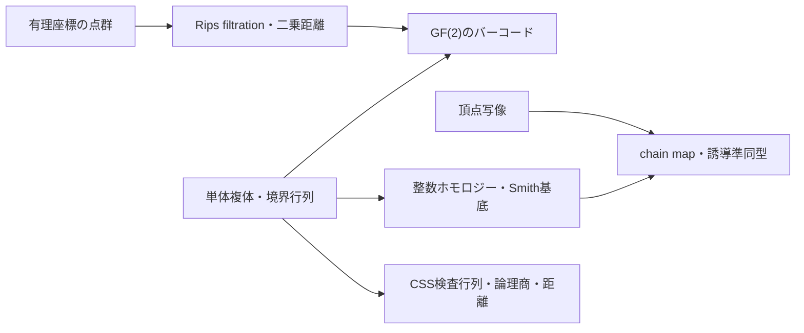

# 位相・持続ホモロジー・符号

[ハンドブック](../../HANDBOOK.md) / [整数ホモロジーの基礎](connections.md#整数行列から図形の穴とねじれへ)

有限の単体複体から、穴とねじれ、写像が穴を移す作用、尺度に沿った穴の寿命を計算する。
同じ境界行列を二進化すると、CSS符号の検査行列と論理演算子の商にもなる。



| 求めたいもの | 入口 | 返すもの |
| --- | --- | --- |
| 一つの複体の整数ホモロジー | [homology](../../src/homology/pkg.generated.mbti) | 自由rank、ねじれの不変因子、整数基底変換の証拠 |
| 頂点写像がホモロジーへ与える作用 | [simplicialmap](../../src/simplicialmap/pkg.generated.mbti) | 向きを含むchain map、Smith座標での誘導準同型 |
| 有限filtrationでの穴の寿命 | [persistence](../../src/persistence/pkg.generated.mbti) | GF(2)の有限・無限区間、単体のpairing、疎な行列変換 |
| 有理点群からfiltrationを作る | [rips](../../src/rips/pkg.generated.mbti) | 次元上限を指定した、二乗距離によるVietoris–Rips filtration |
| 境界から符号を作る | [csscode](../../src/csscode/pkg.generated.mbti) | 検査行列のrank、論理ビット数、syndrome、論理演算子の最小重み |

```sh
tools/moon run src/cmd/topology
```

引数 `rips`、`maps`、`codes` で各部分だけを実行できる。
確認した出力は[位相ツアー](../TOPOLOGY_TOUR.txt)、実装上の判断は[探索記録](../research/topology-20261117.md)に保存する。

## 穴がいつ生まれ、いつ消えるか

filtrationは、単体をgradeが小さい順に追加する複体の列である。
`persistence.validate` は各単体の頂点が狭義昇順、重複なし、gradeが非減少、
すべての面が先に存在することを検査する。gradeは厳密な有理数で、同じ値も使える。

GF(2)では向きの符号が消え、境界列の加算は疎な頂点番号列の対称差になる。
境界行列Dを左から列還元し、

\[
R=DV
\]

を保つ。Vは対角が1の上三角行列で、同じ単体次元の基底だけを混ぜる。
Rの非零列の最後の非零行が重ならなくなると、その行の単体の誕生と列の単体の死を組にできる。
死と組にならない誕生は無限区間になる。

バーコードは半開区間 `[birth,death)`。同じgrade内だけで生まれて消える区間は表示から除き、
単体番号によるpairingには残す。同grade内の順序を変えると単体番号の組は変わり得るため、
尺度の不変量を比較するときは次元とgradeの区間の多重集合を見る。

`run` は列操作と確定した列数の二つの燃料を受け取り、`Paused` の状態へ燃料を足して再開できる。
入力境界の構成、疎リスト走査、最終検査まで実時間で制限するものではない。
検査器は元のfiltrationからDを作り、`R=DV`、Vの形、pivot、pairing、実際の返却バーコードを検査する。
探索をもう一度実行して一致だけを見る方式ではない。

## 点群の距離を近似せず扱う

`rips.cloud` は固定次元の有理座標を受け取る。距離二乗を一度計算し、単体のgradeを
その頂点間の最大二乗距離とする。平方根も浮動小数点も必要ない。
通常の距離を閾値とする規約と比べると、パラメータを二乗したものに相当する。

一辺1の正方形の四点では、H1の区間は `[1,2)` となる。
1で外周四辺がつながり、2で対角線と三角形が入り輪が埋まる。
三角形まで含む複体では、その瞬間に四面体の境界がH2として残る。
四面体も含めるとH2は消える。Hkを完全なRips複体と比較するには、少なくともk+1単体まで必要である。

重なった座標も別の頂点として保ち、grade 0の辺がそれらを結ぶ。
空の点群、零次元の点、同じgradeの多数の単体にも対応する。
構成は有限の一括処理で、単体数は最大で `sum binomial(n,j)`。
明示的な全単体構成のため、大きな点群を想定したRipserの代替速度を主張しない。

## 写像の向きと整数のねじれを保つ

単体写像は、元の全頂点に対する行先を指定し、各単体の像が先の複体に存在することを検査する。
頂点がつぶれる退化した単体は、同じ次元のchainでは0へ送る。
退化しない場合は、像の頂点を昇順へ並べる置換の符号を整数係数へ反映する。

得た行列Fは `d_target F = F d_source` を満たす。
整数サイクル基底への移動と境界の像への下降を検査し、既存のSmith標準形を使って誘導写像を得る。
円周の反転ではH1を−1倍し、円周から中を埋めた三角形への包含ではH1を0へ送る。

`HomologyMap.classes` と `apply` の座標は、Smith余核の全ambient座標である。
対角が1の自明な成分も0のslotとして残す。ねじれ成分は正の剰余、自由成分は符号付き整数になる。
自由rankとねじれだけを並べた短縮ベクトルをそのまま渡す形式ではない。
元のSmith左変換U_sourceの逆で代表を戻し、cycle mapを適用してから、先のU_targetで正規化する。
二つの変換を取り違えると、別の基底で表した同じ群の写像を誤る。

## 境界からCSS符号へ

次数kの単体を物理ビットの座標とし、

\[
H_X=d_k\bmod 2,\qquad H_Z=(d_{k+1}\bmod2)^T
\]

と置く。境界の境界が0なので、`H_X H_Z^T=0` となる。
ここでの二進加算はXORである。BoolのOR/AND半環を代用すると、この可換条件を誤る。

\[
k_{logical}=n-\operatorname{rank}H_X-\operatorname{rank}H_Z.
\]

Z型の論理演算子は `ker H_X / rowspace H_Z` の非零類、
X型は `ker H_Z / rowspace H_X` の非零類である。
前者はGF(2)ホモロジー、後者はコホモロジーに対応する。
syndromeは、X誤りにはH_Z、Z誤りにはH_Xを掛けて得る。

最小距離は重みの小さい候補から列挙して求める。
候補数の燃料で中断・再開できるが、最悪の場合は指数時間になる。
論理ビット数が0なら非自明な論理演算子がなく、距離は `NoLogical` となる。
返却ベクトルの非自明性は短く検査できるが、最小性の検査は小さい重みの候補を再列挙する。
この再検査も燃料で再開でき、安価な最小距離証明とは主張しない。

射影平面では整数H1がZ/2で、自由rankは0でもGF(2)のH1は一次元になる。
整数の結果を有理数のrankへ置き換えてから二進化すると、この成分を取りこぼす。
GF(2)ではH2にも一次元の類が現れる。係数変更とねじれの関係は
[Hatcher §3.Aの普遍係数定理](https://pi.math.cornell.edu/~hatcher/AT/ATch3.4.pdf#page=4)に対応する。

## 検査と残る範囲

rankの証拠は `R=UA`、Uの両側逆、RREFの構造を検査する。
整数誘導写像は元と先のホモロジー証拠を再検査し、基底変換と境界への下降を確かめる。
点群adapterは個々の単体の距離と、二項係数から数えた全単体数を照合する。
いずれも要求した入力と実際の返却値を結び付け、別問題の正しい証拠の流用を拒否する。

独立な有限参照では、prefix間のrank invariant、向き付き頂点写像、bitmaskでの論理商と最小重みを調べる。
対象範囲と実行結果は各研究記録と[検証ガイド](../VALIDATION.md)に記す。
これらは実行時検査と有限照合であり、新しい核全体のLean証明ではない。
多パラメータ持続性、cup積、基本群の自動抽出、複体簡約、量子状態のシミュレーションは含まない。
