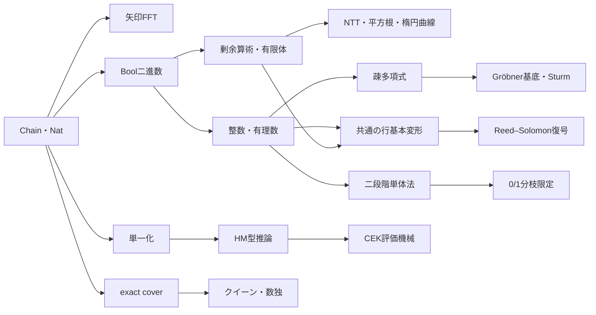

# 探索とリファクタリングの記録

[ドキュメント](../README.md) / [研究・探索記録](README.md)

2026-11-15〜16の探索中に書いた考察・判断・検証結果を保存する。
作業場所、期限、テスト数、公開状況は各時点の記録であり、現在の作業指示ではない。
現在の実装は[ハンドブック](../../HANDBOOK.md)、検証済みの到達点は[最終スナップショット](../bootstrap/RESULTS-20261116.md)を参照。

## 読み始める順序

まず `tools/moon run src/cmd/main` を実行すると、後述のアルゴリズムの結果をまとめて見られる。
[保存した出力](../TOUR.txt)もある。核のソースだけを読む場合は次の経路が分かりやすい。

1. **画像との対応**：coreのChainを読み、fftへ進む。FFTはBinaryもRationalも必要としない。
2. **連結から数へ**：binaryのfull_adderとpair、bitcodecのgamma、modular、NTT、SHA-256へ進む。
3. **木の意味を変える**：unifyの置換とoccurs check、inferのlet多相、cekの評価状態を読む。
4. **厳密計算を積む**：exactからpolynomial、Gröbner/Sturm、またはmatrix/linear/simplexへ進む。

矢印は考え方の依存を示す。正確なimportと公開APIは各moon.pkgとpkg.generated.mbtiが正本。
各話題の検証は同じディレクトリのwbtest.mbtに置く。
性能上の比較は[計測記録](../MEASUREMENTS.md)、具体的な検証範囲と限界は以下の各節を参照する。

## 目的と実験の境界

2026-11-15、画像に示された12本の等式による FFT を出発点に、MoonBit の
ADT とパターンマッチだけでどこまで算法を構成できるか試す。
利用者はコードを読んで改造したい人。性能上の実益を後付けせず、表現と計算の関係を調べる。
今回の作業場所は `/home/hosi/morph`、区切りは同日22:00 JST。

「純記号」は**手書きのアルゴリズム本体**に組み込み数値型・数値リテラル・
数値演算・配列・可変状態を使わない、という操作可能な条件とする。
MoonBit のコンパイラ、GC、暗黙の prelude、テストランナーの内部まで排除する主張ではない。
`derive(Eq, Debug)` はテストと観察の補助であり数値計算への抜け道には使わない。
テスト側だけは Int、配列、ループを使い、別表現のオラクルと比較する。

## 開発環境

既存のグローバル環境は MoonBit v0.8.2。変更せず、公式配布を `.tools/moon` に隔離する。
`tools/moon` がこのツールチェーンを優先する。外部 Mooncakes 依存は追加しない。
設定は公式の現行 `moon.mod` / `moon.pkg` 形式を使う。

- [公式インストール](https://www.moonbitlang.com/download/)
- [モジュール設定](https://docs.moonbitlang.com/en/latest/toolchain/moon/module.html)
- [パッケージ設定](https://docs.moonbitlang.com/en/latest/toolchain/moon/package.html)

## 整理の記録：検証境界をコードで固定

最初の5段階を終えたところで、複数パッケージに重複していた数値変換を
`testsupport` に集約した。各ライブラリはテスト時だけこのパッケージを取り込む。
`tools/audit_purity.py` はコメントと文字列を除き、手書きの核に数値型・数値リテラル・
数値演算・可変状態・配列・FFI がないか検査する。テスト用オラクルの本番 import も拒否する。
これは保守のための保守的なソース検査で、コンパイラが生成するコードや停止性の証明ではない。

`tools/check` で純記号制約、整形、警告なしの型検査、Wasm GC と JS の両テスト、
公開型定義の生成をまとめて実行する。最初の全体検証は両 backend とも13テスト成功。
実行環境は moon 0.1.20261104 / moonc v0.10.20+65efd5b93。

## 整理の記録：実測して中間構造を減らす

Warshall は各pivotで全行列を転置し、その一列だけを使っていた。
必要な列を直接抽出する `column` に置き換え、同じ24頂点の入力・native releaseで
平均665.55µsから361.14µsへ短縮した（各10サンプル）。
全グラフの照合と全体の Wasm GC/JS テストは維持。
詳細条件と生ログは [計測記録](../MEASUREMENTS.md) を参照。
有理数除算も、非ゼロの証拠と逆数の共通APIへ寄せ、消去法と重複する符号処理を減らした。
型検査とソース制約の全検証は30テストの時点で再通過。

## 全体の入口を揃える

45テストが Wasm GC / JS の両方で通った時点で、README に分野別の入口一覧を追加。
`tools/moon run src/cmd/main` で、単なる期待値の表示でなく実際に各 API を呼ぶツアーを用意した。
表示用の数値変換と文字列整形は cmd/main に限定し、核の制約は緩めていない。
`tools/check` はこの境界も検査する。

## 整理の記録：不変条件を使って共有を増やす

単一化の置換は、束縛を追加するたびに既存の全値域へ合成している。
したがって値域には定義域の変数が残らず、変数を引いた後でもう一度置換を走査する必要がない。
この条件をテストで直接調べてから、`apply` が束縛値をそのまま共有するよう変更した。
深さ6の共有項への束縛参照は2.69µsから9.08nsになった。
これは値域参照だけの microbenchmark で、置換構築や型推論全体の速度比ではない。
型推論・CEKとの組合せを含む45テストを両backendで再検証した。
条件と生ログは [計測記録](../MEASUREMENTS.md) に残す。

## 整理の記録：代数の判定条件で計算を省く

Buchberger の積判定を導入した。先頭単項式が互いに素なら、そのS多項式は二つの多項式で
ゼロへ還元できるため、生成と除算を省く。指数リストの同じ位置が両方非ゼロか調べるだけでよい。
燃料は省略したペアも一処理として数え、再開インターフェイスの意味を保つ。
分離二次系では18.51→4.48µs、結合二次系では184.06→111.19µs（native release）。
SymPyの45系と全体97テストを再検証し、条件と生ログを [計測記録](../MEASUREMENTS.md) に保存した。

## 整理の記録：数値境界の検査自体も確かめる

制約検査に Int32/UInt32 などの別名、文字・文字列リテラル、追加の機械演算トークンを含めた。
コメント内の仕様の数値を誤検出せず、実コードのリテラルを見逃さないことを、検査器自身の
小さなテストで確認する。テスト用 import の例外も basename ではなく実際の cmd/testsupport 配下に限定した。
これは保守的なソース検査であり、MoonBit の型付き AST 全体を解析する完全な証明ではない。
また CRT と逆元で重複した符号付き剰余処理を `signed_reduce` に集約した。

## 整理の記録：純記号のまま表現コストを下げる

9×9数独の全処理を計測すると、Natの制約IDの比較が繰り返される構造だった。
入口でIDを一度 Binary へ変換してキャッシュし、検索と入力検査で共有するよう変更した。
公開APIと元の問題・解はNatのまま、解の検査も元の制約で行う。
整数・配列・可変状態を導入せず、値に比例するID比較を桁数に比例する比較へ置き換えた。

この数独では平均1.07s→121.81ms（約8.8倍）。入力検査や変換も含む比較である。
全4096被覆問題とNクイーン・数独の検証を維持し、全体117テストも両backendで通過。
キャッシュの追加メモリと、問題ごとの速度差は残る。詳細は [計測記録](../MEASUREMENTS.md)。

## 整理の記録：上位へ進んだら共通算術を測り直す

多項式、最適化、微分、幾何がすべてexact.Rationalを共有する段階で、
分母を掛けてから全体をgcdで約分する方式を見直した。
和は分母のgcdを共有し、積は互いの分子・分母を先に約分する。
既約入力から既約結果が得られるので、最後の巨大な正規化は要らない。
ゼロ、±1、除数1も同じ核で扱い、既存の表現と結果を保った。

交差約分だけでは大きな共通因子の例は改善したが、小さな分数の多い単体法は悪化した。
恒等則を合わせて初めて、今回の単体法は131.72→40.81µs、Sturmは220.82→92.28µsになった。
小分数23409組と既存の上位オラクルを維持した。詳細は[計測記録](../MEASUREMENTS.md)。

## 整理の記録：行基本変形を体の辞書で共有する

Reed–Solomon復号へ進む前に、有理数専用だったGauss–Jordanをrowreduceへ抽出した。
ゼロ・一・和・差・符号反転・積・逆元のField辞書を渡し、
rref、行列式、逆行列、特解と核の基底を同じ実装で計算する。
既存linearの公開型と関数は薄い有理数アダプターとして保ち、従来の独立オラクルを維持する。
有限体はfinitefield.arithmeticから辞書を作る。
Fieldは体の法則を満たす操作の辞書であり、その法則を型で証明したものではない。

F3上の全81個の2×2行列×全9右辺を全9割当てと比較した。
有理4×4逆行列の同じnative releaseベンチは119.50±2.13→118.47±2.27µsで、
誤差範囲が重なるため高速化とは扱わない。ここでの成果は核の重複を避けたこと。

## 今回確かめられたこと

組み込み数値を避けても、算法の表現はかなり先へ進められた。
同じChainから、矢印の形式和、二進整数、環の多項式、制約、構文木、探索状態を作れる。
FFTだけでなく、型推論、Gröbner基底、二段階単体法、0/1最適化、実根隔離、
誤り訂正まで、独立な小例や外部オラクルと比較できる形になった。
これは新しい計算可能性の結果や数値ライブラリの性能優位を示すものではなく、
表現を組み立てて計算の中身を追える教材としての到達点である。

同じ意味の値でも、表現の選択でコストが変わる。
位相を展開する矢印、値そのものまで伸びるPeano数、桁数だけ伸びる二進数は、
同じ「加算」という名前でも作るデータ量が違う。
数独のIDを二進化した比較や有理数の交差約分では、
算法の大筋を変えずに表現コストを下げる効果を実測できた。
逆に、交差約分だけでは小さな係数の単体法が悪化し、恒等則も必要だった。

抽象化の効果は再利用の場所で見えた。
半環で行列や前向きADの意味を変え、体の辞書で同じ行基本変形を
有理数の解空間とReed–Solomon復号へ使えた。
trieを辞書、Aho–Corasickの状態表、LZ78の番号表へ使い、
exact coverをクイーンと数独へ、LPの証拠を0/1探索の証拠木へ積めた。

探索結果と根拠を分ける設計も共通化できた。
SATの反証、最大流のカット、マッチングの被覆、LPの双対解、分枝限定の木は、
見つける処理とは異なる、探索しない検査を持つ。
ただし検査器もプログラムであり、共通の算術や変形を信頼している。
有限の総当たり・外部オラクルとの比較を、全入力の形式証明へ言い換えない。

## 第1回探索の検証と引き継ぎ

42パッケージの核（定数データを含む56ファイル）を実装し、
166テストをWasm GC・JavaScript・nativeで確認した。
ソース制約検査にもPythonの3テストがあり、通常の `tools/check` で一緒に実行する。
データの全組合せを一つのテスト内で走査するものもあるので、166は比較例の総数ではない。
実行ツアーの29行は三つのbackendで完全一致した。
全13ベンチグループと、5スクリプトによる期待値再生成の無差分も確認した。

成果と理由ごとにローカルコミットを作成した。remoteへのpush・PR・公開・デプロイは行っていない。
ツールチェーンとビルドキャッシュは次にすぐ実行できるように保持する。
一時的な出力・不要な原資料アーカイブは取り除き、参照したRSPとツールチェーンの取得物は再現用に残す。
アルゴリズムごとの限界は上の各節、実測の条件は[計測記録](../MEASUREMENTS.md)が正本である。

## SATから基礎へ戻すbootstrap

第2回は「既存SATを検証・合成に使い、基礎を最適化して上位へ戻す」という
ユーザーの追加方針で、4時間を上限に探索する。[全体記録](../bootstrap/TRACE.md)を入口とする。

- [円分体と厳密FFT](../bootstrap/cyclotomic.md)：矢印を延々と展開する代わりに、
  円分多項式による正規形と逆元を使う。原FFTの意味を失わず、逆FFTまで合成できる。
- [証拠付きCDCL](../bootstrap/sat-engine.md)：first-UIP・watch・backjumpを不変構造だけで実装。
  問題によってDPLLより遅い例も残し、[独立レビュー](../bootstrap/review-cdcl.md)で証拠と境界を調べる。
- [回路検査](../bootstrap/circuits.md)と[NAND合成](../bootstrap/synthesis.md)：
  同じBoolean代数のプログラムをBoolでも式ADTでも解釈し、miterと合成CNFへ渡す。
- [素数証明と分解](../bootstrap/number-theory.md)：Lucas/Pratt、部分Pocklington、合成数の証拠、
  Pollard rhoの分割、完全分解を別の型で表す。MR通過を素数の証明へ昇格しない。
- [有限体](../bootstrap/finitefields.md)：検査済み素数→Fp多項式→Berlekamp分解→
  既約性証拠→GF(p^m)という順に積む。[離散対数](../bootstrap/discretelog.md)もこの境界を使う。

SATの独立レビューでは、変数番号65535だけのunit節からJS/Wasmのstack overflowが見つかった。
profileでも同じNat→二進ID変換が入口を支配していた。
[末尾再帰・incrementのsuffix共有・構造的半分化](../bootstrap/naturals.md)を段階比較し、
SAT専用の改善候補を共通のBinaryへ戻す。これは上位の算法が基礎の問題を発見する例になった。

[加算のsuffix共有](../bootstrap/addition.md)も上位の乗算を改善したが、
同じ幅のdense加算には悪化が残った。さらにcarry-mux式は等価でも実測で遅く、核への採用を見送った。
「証拠があるので意味は同じ」と「このbackendで速い」は別の判断である。

定型作業は`tools/check`へまとめる。純粋性の字句検査、警告禁止、整形、2backendのテストに加え、
コンパイラが生成する公開API snapshotの差分を検出する。
`python3 tools/inventory.py`は[算法・依存・テスト宣言の一覧](../INVENTORY.md)を生成する。
宣言数と実行成功数、有限検査と形式証明を混同しない。
主要な主張と信頼境界は[検証台帳](../bootstrap/verification-ledger.md)で対応付ける。

その後、[Berlekamp–Masseyと巡回RS](../bootstrap/cyclic-rs.md)をGF(256)・255長まで接続し、
[AES](../bootstrap/aes.md)はSboxを有限体逆元から生成して全3鍵長のblock暗号・復号を構成した。
NISTの中間状態やOpenSSLの別実装と照合する。
[Smith標準形](../bootstrap/smith.md)から整数方程式とアーベル群へ進み、
[LLL](../bootstrap/lll.md)は近似を使わず、同じ整数格子を表す証拠と簡約条件を検査する。
[BDD](../bootstrap/bdd.md)と[SMT](../bootstrap/smt.md)も、SATと異なる意味の層を往復するための部品になった。

[圧縮二進算術](../bootstrap/runbinary.md)では、長い同一bit列をrun単位で扱い、
通常のbit列を作れない巨大値でも加減乗算・pair・限定した除算を行う。
一方で交互bitの多い入力は遅くなるため、通常のBinaryと使い分ける。
[独立レビュー](../bootstrap/review-runbinary.md)で巨大値の境界も追試した。

ユーザーの追加指示で、以降は共有カーネルの高速化を最優先にする。
新しい上位算法の追加は一度区切り、binary、exact、有限体/多項式、SAT証拠検査を分担して
profile・候補探索・同入力比較・上位算法への再計測を行う。
必要な候補にはSAT/BDDや[Leanモデル](../../formal/README.md)も使う。
モデル定理とMoonBitへの手動の構造対応は、[別担当のレビュー](../../formal/REVIEW.md)でも区別した。

ユーザーの利用経路監査を受け、Natの半分化を共有Coreへ戻した。
Fp多項式の既約性検査二箇所と円分体の次数は、Nat→Binary→Natを経由しない。
初回はBinary converterも同じ`halve_nat`へ集約した。
その後の[8進単位の変換](../bootstrap/nat-radix-grouping.md)では、三bitずつ出力する
専用helperへ進めた。Coreの半分化はFp・円分体・2冪判定で引き続き利用する。
`half_nat`のfloorの意味はLeanモデル、0〜4096と大きなNatは実行テストで確認する。

[呼び出し経路の一覧](../CALL_PATHS.md)は内部参照のない公開API、実際の利用経路、
独立表現のrunbinaryを区別する。実装の存在だけで全体へ統合したとは扱わない。
直接的な数値表現の往復は`tools/audit_paths.py`で検出し、`tools/check`へ組み込む。
変数経由の冗長性や実行頻度はこの字句検査の守備範囲外であり、profileとレビューも続ける。

[適応除算と剰余](../bootstrap/adaptive-division.md)は、幅差の近い入力を整列減算で処理する。
GCDとModular.reduceは商を作らない共通kernelへ接続した。
[不変の0/1](../bootstrap/binary-constants.md)は割当を減らし、LLL等の固定入力でも前後比較した。
[有理数の直接減算](../bootstrap/rational-subtraction.md)では中間の否定値を省く。
これらの採用・未採用・実際の利用先は[KERNELS](../KERNELS.md)へまとめ、
値のモデル・canonical性・有限oracle・速度の証拠を区別する。

[比較kernel](../bootstrap/binary-comparison.md)は、短い語の既存経路を保護し、
長い語を四node単位のtail loopへ渡す。全有限raw列の旧実装との一致と、
canonicalな列の数値順序をLeanで別々に検査した。
[4bit積](../bootstrap/tiny-products.md)と[小さい差](../bootstrap/tiny-differences.md)は、
Bool列の有限表と不変の結果を共有し、外域では通常の算法へ戻る。
積の定数はさらにsuffix DAGで共有し、追加Consを544から100へ減らした。

[大きい語の追加実験](wide-kernels/README.md)は未採用である。
JSの2^20000の通常剰余にはstack制約が残る。tail化だけで値とstackの問題が解決しても、
nativeの速度が改善するとは限らなかった。失敗案とgeneric foldの証明を残し、
未採用の試作を通常経路の性能として報告しない。
